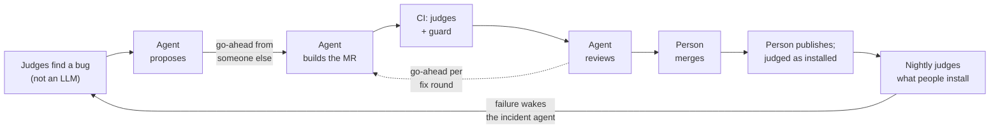

# If you're evaluating this entry: polyman on GitLab (Path B · Assisted)

**Check it yourself, no login:** [live verify service](https://polyman-verify-ncvkutguda-ue.a.run.app) · [go-ahead ledger](https://showcase-ce2cdc.gitlab.io/ledger/) · [agent carbon](https://showcase-ce2cdc.gitlab.io/sci/) · [Assisted in 60 seconds](#assisted-in-60-seconds)

**[44 of 44 loops and 63 of 63 agent pushes](https://gitlab.com/gitlab-ai-hackathon/transcend-october-2026/30770856/showcase/-/jobs/17418251989) ran on a go-ahead from someone other than the requester · [3 people](https://showcase-ce2cdc.gitlab.io/ledger/), and the one who asks never gives the go-ahead · [719 Duo agent sessions](sustainability/agent-tokens.json) · the published 3.0.0 got the expected verdicts on [0 of 5 corpus problems, 3.0.1 on 5 of 5](https://gitlab.com/gitlab-ai-hackathon/transcend-october-2026/30770856/showcase/-/jobs/17267989872).** _Ledger job 23 Oct 13:59 UTC; sessions Oct 16 18:58 to Oct 23 12:59 UTC; release check Oct 18._

polyman is an MIT command-line tool that people who set programming-contest problems use to check that every solution gets the right verdict. On GitLab, Duo agents maintain it one step at a time: each step waits for a go-ahead from a person who didn't ask for the work, and nothing reaches npm `latest` until programs, not an LLM, agree it still judges at least as well as the last release. Every link below opens without logging in. GitLab shows agent session pages only to signed-in members, so three sessions are rendered from the API in the wiki: [#21 from proposal to review](https://gitlab.com/gitlab-ai-hackathon/transcend-october-2026/30770856/showcase/-/wikis/Session-replay-21), [the #45 incident](https://gitlab.com/gitlab-ai-hackathon/transcend-october-2026/30770856/showcase/-/wikis/Session-replay-45), and [a review agent told "REPORT ONLY: do not push" pushing anyway](https://gitlab.com/gitlab-ai-hackathon/transcend-october-2026/30770856/showcase/-/wikis/Session-replay-67).

Agent session links need project access; the wiki session replays are the public copy.

**Why it matters now:** a wrong verdict from polyman means a broken problem in a live contest round, with wrong expected answers or a bad test that reaches contestants, and real setters use it ([who uses it](README.md#who-uses-it)). Every problem polyman creates ships instructions for AI coding agents that call `polyman verify` "the bar for 'done'" ([template/instructions/commands/verify.md](https://gitlab.com/gitlab-ai-hackathon/transcend-october-2026/30770856/showcase/-/blob/main/template/instructions/commands/verify.md)) and offer `verify --json` "for agents and scripts". In the release people installed, 3.0.0, that JSON marked tests the checker never judged as `OK` ([#21](https://gitlab.com/gitlab-ai-hackathon/transcend-october-2026/30770856/showcase/-/issues/21)), and `remote push` printed ✓ and exited 0 while uploads failed ([#25](https://gitlab.com/gitlab-ai-hackathon/transcend-october-2026/30770856/showcase/-/issues/25)). The signal agents were told to trust was wrong. So here, every layer that decides something has a judge that isn't an LLM, and every step an agent takes waits for a person who didn't ask.

## Assisted in 60 seconds

One loop you can click through without logging in: [#95](https://gitlab.com/gitlab-ai-hackathon/transcend-october-2026/30770856/showcase/-/issues/95), a test that failed on GitLab's Windows runner, from the agent's proposal to a person's merge, with three different people at the three decisions. Then one push the guard refused. Times are UTC on 20 Oct, from GitLab's note, job and MR records.

1. **The agent proposes and waits.** 10:17: issue-builder's [proposal on #95](https://gitlab.com/gitlab-ai-hackathon/transcend-october-2026/30770856/showcase/-/issues/95#note_4049072276), one line in one test. Ahmed filed the issue at 09:43. No code yet.
2. **Someone who didn't ask gives the go-ahead.** 11:41: [Mazen's go-ahead](https://gitlab.com/gitlab-ai-hackathon/transcend-october-2026/30770856/showcase/-/issues/95#note_4049617768). At 11:44 the agent pushes and opens [!186](https://gitlab.com/gitlab-ai-hackathon/transcend-october-2026/30770856/showcase/-/merge_requests/186) (GitLab shows Mazen as its author, because the agent ran on his go-ahead; the commit, 4adf5bb3, is issue-builder's).
3. **CI matches that push to that go-ahead.** 11:47: [`autonomy:goahead`](https://gitlab.com/gitlab-ai-hackathon/transcend-october-2026/30770856/showcase/-/jobs/17314262589) logs "push at 2026-10-20T11:44:35.527Z ... (4adf5bb3): go-ahead in note 4049617768 on #95 by @Mazen-Ghanaym", risk low. The rule it applies: [`engine/src/goahead.ts`](https://gitlab.com/gitlab-ai-hackathon/transcend-october-2026/30770856/showcase/-/blob/bc8597bed80372d9bc97e9578cbfe654c15d4120/engine/src/goahead.ts#L205).
4. **The review names who merges.** 13:19: [the review](https://gitlab.com/gitlab-ai-hackathon/transcend-october-2026/30770856/showcase/-/merge_requests/186#note_4050323845) says "ready to approve" and "Merge: @HamzaHassanain approves and merges", because Ahmed asked for the work and Mazen gave the go-ahead.
5. **A person merges.** 14:02: Hamza merges [!186](https://gitlab.com/gitlab-ai-hackathon/transcend-october-2026/30770856/showcase/-/merge_requests/186), 2 h 21 min after the go-ahead.
6. **A refusal.** 10:28 and 10:31, on [!177](https://gitlab.com/gitlab-ai-hackathon/transcend-october-2026/30770856/showcase/-/merge_requests/177): the review agent had a go-ahead, but its three commits changed `corpus/survivors.mjs` and its test, files only people may change. [`autonomy:guard`](https://gitlab.com/gitlab-ai-hackathon/transcend-october-2026/30770856/showcase/-/jobs/17312251799) failed ("Agents may not change the pipeline, the risk policy or the engine. Revert these changes or have a person make them.") and so did [`autonomy:goahead`](https://gitlab.com/gitlab-ai-hackathon/transcend-october-2026/30770856/showcase/-/jobs/17312251800) ("changes files only people may change"; the rule: [`engine/src/goahead-mr.ts`](https://gitlab.com/gitlab-ai-hackathon/transcend-october-2026/30770856/showcase/-/blob/bc8597bed80372d9bc97e9578cbfe654c15d4120/engine/src/goahead-mr.ts#L158)). !177 was closed without merging.
7. **The ledger row.** On the [ledger page](https://showcase-ce2cdc.gitlab.io/ledger/), under "One row per loop": #95, requester @Ahmad-Faraj, go-ahead @Mazen-Ghanaym 11:41, !186, merged by @HamzaHassanain 14:02. Under "Every agent push", record 38 is the 4adf5bb3 push with the proposal note, the go-ahead note and "guard: success".

Across every loop so far: the go-ahead never came from the person who asked, in 44 of 44 loops and 63 of 63 agent pushes, and the guard refused 9 agent pushes on 8 MRs since it reached `main` on 17 Oct 20:11 (7 on 18 Oct for no go-ahead, !177 above, and on 22 Oct one push on !241 that broke two rules: a merge commit, with no proposal before it). *Counted by the [ledger job](https://gitlab.com/gitlab-ai-hackathon/transcend-october-2026/30770856/showcase/-/jobs/17418251989) on `main`, 23 Oct 13:59 UTC, which rebuilds every loop from GitLab's note and push records ([`engine/src/ledger.ts`](https://gitlab.com/gitlab-ai-hackathon/transcend-october-2026/30770856/showcase/-/blob/bc8597bed80372d9bc97e9578cbfe654c15d4120/engine/src/ledger.ts#L212)).*

The risk tiers are fixed on purpose: an agent never raises its own level, only a person does. The risk score from `.autonomy.yml` decides how deep the review is, the go-ahead guard `autonomy:goahead` decides who may let an agent act, and an agent push that changes either one fails CI (step 6 above).

## Four more clicks

1. [#45](https://gitlab.com/gitlab-ai-hackathon/transcend-october-2026/30770856/showcase/-/issues/45): on Oct 18 at 03:20 UTC an agent opened an incident: the nightly judges had caught the published `polyman-cli@3.0.0` accepting wrong solutions.
2. [#21](https://gitlab.com/gitlab-ai-hackathon/transcend-october-2026/30770856/showcase/-/issues/21): issue-builder's [proposal](https://gitlab.com/gitlab-ai-hackathon/transcend-october-2026/30770856/showcase/-/issues/21#note_4036864596), [Hamza's go-ahead](https://gitlab.com/gitlab-ai-hackathon/transcend-october-2026/30770856/showcase/-/issues/21#note_4037554981) (Ahmed filed it), [!73](https://gitlab.com/gitlab-ai-hackathon/transcend-october-2026/30770856/showcase/-/merge_requests/73) three minutes later, [the guard checking that go-ahead](https://gitlab.com/gitlab-ai-hackathon/transcend-october-2026/30770856/showcase/-/jobs/17264913912), [the review](https://gitlab.com/gitlab-ai-hackathon/transcend-october-2026/30770856/showcase/-/merge_requests/73#note_4037615431), a person's merge.
3. [`release:next-check`](https://gitlab.com/gitlab-ai-hackathon/transcend-october-2026/30770856/showcase/-/jobs/17267989872): both versions installed from npm the way users get them and judged: 3.0.0 matches 0 of 5 problems, 3.0.1 matches 5 of 5. Then a person made 3.0.1 `latest`: [Release v3.0.1](https://gitlab.com/gitlab-ai-hackathon/transcend-october-2026/30770856/showcase/-/releases/v3.0.1). The gate that makes `latest` wait for this job: [`.gitlab/ci/release.gitlab-ci.yml`](https://gitlab.com/gitlab-ai-hackathon/transcend-october-2026/30770856/showcase/-/blob/bc8597bed80372d9bc97e9578cbfe654c15d4120/.gitlab/ci/release.gitlab-ci.yml#L59).
4. [`autonomy:goahead` on !67](https://gitlab.com/gitlab-ai-hackathon/transcend-october-2026/30770856/showcase/-/jobs/17265270744): the "no" path. A review agent pushed code nobody approved; CI refused it.

## The rules, and where each is met

| Requirement | Where |
|---|---|
| Public project, MIT licence detected by GitLab | this project; [LICENCE](LICENCE) (About: "MIT License") |
| Original MIT project (Path B) | [HamzaHassanain/polyman](https://github.com/HamzaHassanain/polyman), imported at `dcb5779` (3.0.0, Sep 25), tagged [`hackathon-start`](https://gitlab.com/gitlab-ai-hackathon/transcend-october-2026/30770856/showcase/-/tags/hackathon-start) |
| Automation and deployment are new since Oct 5 | everything under [`.gitlab/`](.gitlab), [`engine/`](engine), [`corpus/`](corpus), [`service/`](service), [`sustainability/`](sustainability), `.gitlab-ci.yml`, `.autonomy.yml`; the first GitLab pipeline ran Oct 16 ([Before-After](https://gitlab.com/gitlab-ai-hackathon/transcend-october-2026/30770856/showcase/-/wikis/Before-After)) |
| CI/CD history shows the automation running | [pipelines](https://gitlab.com/gitlab-ai-hackathon/transcend-october-2026/30770856/showcase/-/pipelines); agent sessions run as pipelines with source `duo_workflow` |
| Uses GitLab Duo Agent Platform | four custom flows in [`.gitlab/duo/flows/`](.gitlab/duo/flows) (issue-builder, mr-reviewer, pipeline-fixer, incident-responder), plus GitLab's Code Review flow and Vulnerability Resolution |
| Deployed, public, live | [polyman verify on Cloud Run](https://polyman-verify-ncvkutguda-ue.a.run.app) (`/health`; one instance is kept warm through judging, [!193](https://gitlab.com/gitlab-ai-hackathon/transcend-october-2026/30770856/showcase/-/merge_requests/193), warm since the [promote of Oct 20 20:32 UTC](https://gitlab.com/gitlab-ai-hackathon/transcend-october-2026/30770856/showcase/-/jobs/17329028634); the revision serving now, d65225ea, was [promoted on Oct 22 at 16:53 UTC](https://gitlab.com/gitlab-ai-hackathon/transcend-october-2026/30770856/showcase/-/jobs/17390024107); five `/health` requests took 0.28-0.31 s, median 0.29 s, on 21 Oct 12:35 UTC). Each instance checks one upload at a time and at most three run, so if the page says "busy with another verification, try again shortly" (HTTP 429, `retry-after: 30`), wait about 30 seconds and try again |
| Google Cloud code in the repository | [`service/deploy/`](service/deploy) (Cloud Run, Workload Identity Federation, egress-denied VPC), [`service/ci/service.gitlab-ci.yml`](service/ci/service.gitlab-ci.yml) |

## By judging criterion

### Technological implementation
- **The bug museum** ([wiki](https://gitlab.com/gitlab-ai-hackathon/transcend-october-2026/30770856/showcase/-/wikis/Bug-museum)): the 8 judge-found bugs planted again on today's code. 3.0.0's 967 unit tests caught none of them, the judges caught all 8, and the 1,268 tests on 924a132 fail on all 8 (`main` ran 1,827 on Oct 23, [`test: [22]`](https://gitlab.com/gitlab-ai-hackathon/transcend-october-2026/30770856/showcase/-/jobs/17418251987)) (7 on a real behaviour check), because each agent fix left a test behind. The script reruns it.
- **Four custom flows on the Duo Agent Platform**, published from the repo, with the project's policy filled in at publish time ([`engine/`](engine)). The go-ahead is enforced in CI, not in a prompt: [`autonomy:goahead`](engine/ci/autonomy.gitlab-ci.yml) reads who pushed each commit and finds the go-ahead note for that push, from someone allowed for the change's risk tier and never the requester. Its code and the policy come from the target branch.
- **Judges that are neither an LLM nor ours**: the corpus (real g++, Java and Python on five original problems with deliberately wrong solutions, judged per test), the round trip (what polyman pushed is read back from the problem platform and compared test by test), mutation testing of the verdict code, toolchain lanes, the service's golden set.
- **Release as a chain of custody**: canary in GitLab's npm registry → npm `next` with provenance → both versions installed and judged → `latest` → GitLab Release with the corpus verdicts, mutation report, SBOM and Sigstore entry.
- **A tamper-evident record**: every accepted agent push and the go-ahead it ran on, chained by SHA-256, rebuilt on every `main` pipeline and published: [ledger](https://showcase-ce2cdc.gitlab.io/ledger/).

### Design: one end-to-end workflow

Judge finds a bug → issue with evidence → agent proposes → someone else's go-ahead → agent builds the MR → CI judges it, the guard checks the go-ahead → review agent reports, each fix round on its own go-ahead → a person merges → a person publishes to `next` → judged as installed → a person makes it `latest` → the nightly judges what people install → a failure wakes incident-responder. It ran for real: [44 agent-built changes merged by a person](README.md#what-people-did-per-loop) (12 on Oct 17-18, 9 on Oct 19, 6 on Oct 20, 5 on Oct 21, 5 on Oct 22, 7 on Oct 23; [ledger job](https://gitlab.com/gitlab-ai-hackathon/transcend-october-2026/30770856/showcase/-/jobs/17418251989), 23 Oct 13:59 UTC, merge dates from GitLab's MR records), then [3.0.1](https://gitlab.com/gitlab-ai-hackathon/transcend-october-2026/30770856/showcase/-/releases/v3.0.1) shipped all eight judge-found fixes, 6 h 48 min after the fix for #21 merged and 21 h after the first of the eight.

### Three loops on Oct 19, timed (UTC)

**A failing pipeline, fixed by an agent after a refusal** ([!135](https://gitlab.com/gitlab-ai-hackathon/transcend-october-2026/30770856/showcase/-/merge_requests/135)), 21 minutes from the red pipeline to the merge:
- 13:06 pipeline-fixer proposes a fix for the failing `test: [20]` and `test: [22]` jobs.
- 13:08 Ahmed, who opened the MR, says go-ahead. 13:09 the fixer refuses it: a requester can't approve their own work.
- 13:14 Mazen gives the go-ahead. 13:17 the fixer pushes once; [`autonomy:goahead` accepts that push](https://gitlab.com/gitlab-ai-hackathon/transcend-october-2026/30770856/showcase/-/jobs/17285483032) on Mazen's note.
- 13:25 the review says "ready to approve". 13:27 Mazen merges.

**A bad change reaches production and the project learns from it** ([!127](https://gitlab.com/gitlab-ai-hackathon/transcend-october-2026/30770856/showcase/-/merge_requests/127) → [Incident #65](https://gitlab.com/gitlab-ai-hackathon/transcend-october-2026/30770856/showcase/-/work_items/65) → [!137](https://gitlab.com/gitlab-ai-hackathon/transcend-october-2026/30770856/showcase/-/merge_requests/137) → [#82](https://gitlab.com/gitlab-ai-hackathon/transcend-october-2026/30770856/showcase/-/work_items/82) → [!143](https://gitlab.com/gitlab-ai-hackathon/transcend-october-2026/30770856/showcase/-/merge_requests/143)). This was a drill: we planted a change that refuses every upload without an `Origin` header, which breaks scripts and our own production check.
- 13:18 the review agent flags it as a P1 ("on the public host, a POST with no Origin gets 403"). We merged it anyway at 13:28 to run the drill.
- 13:36 the candidate check passes: the tagged revision URL is exempt, so only the public host shows the bug.
- 13:44:56 a person promotes it. 13:45 [`service:check:production` fails](https://gitlab.com/gitlab-ai-hackathon/transcend-october-2026/30770856/showcase/-/jobs/17285820679) with 403. By 13:46:30 [`service:rollback:production`](https://gitlab.com/gitlab-ai-hackathon/transcend-october-2026/30770856/showcase/-/jobs/17285820680) has moved traffic back on its own. Production was wrong for about a minute and a half.
- 14:04 incident-responder opens Incident #65 with the cause and a rollback proposal. A person had to start it, because the pipeline showed "blocked" rather than "failed" while an optional manual job waited; [!139](https://gitlab.com/gitlab-ai-hackathon/transcend-october-2026/30770856/showcase/-/merge_requests/139) fixes that.
- 14:08 Mazen's go-ahead. 14:11 the responder opens !137: the revert, plus an entry in `.autonomy/incidents.json` that weights `service/src/app.ts` by +25 because of #65.
- 14:21 the review says "ready". 14:40 merged. 14:56 promoted. 14:58 [the production check passes](https://gitlab.com/gitlab-ai-hackathon/transcend-october-2026/30770856/showcase/-/jobs/17288464380). 15:08 the responder checks this against GitLab and records it.
- 15:03 Ahmed files the proper fix (#82). 15:14 Hamza writes "Go Ahead!"; 15:16 issue-builder [refuses it](https://gitlab.com/gitlab-ai-hackathon/transcend-october-2026/30770856/showcase/-/issues/82#note_4043640239), because a go-ahead is the word `go-ahead`. 15:17 Mazen's go-ahead is the one used. 15:22 issue-builder opens !143.
- 15:24 **the learning shows up**: [`autonomy:assess` on !143](https://gitlab.com/gitlab-ai-hackathon/transcend-october-2026/30770856/showcase/-/jobs/17289842520) scores it `risk 60/100 -> high`, with `+25 history: service/src/app.ts: Origin check on the public API refused every script and CI upload (403) (#65)`. Without the incident it would be medium (the history rule: [`engine/src/risk.ts`](https://gitlab.com/gitlab-ai-hackathon/transcend-october-2026/30770856/showcase/-/blob/bc8597bed80372d9bc97e9578cbfe654c15d4120/engine/src/risk.ts#L151)). A high tier means a maintainer's go-ahead and the security reviewer.
- 16:09 that security review finds a P1 in the new check (a percent-encoded path gets past it). 16:23 Mazen's go-ahead. 16:26 the fix round.

**An issue through three fix rounds to the merge** ([#62](https://gitlab.com/gitlab-ai-hackathon/transcend-october-2026/30770856/showcase/-/work_items/62) → [!136](https://gitlab.com/gitlab-ai-hackathon/transcend-october-2026/30770856/showcase/-/merge_requests/136)), a path-traversal fix in `remote push`:
- 12:30 issue-builder proposes. 12:57 Ahmed's go-ahead (Mazen filed the issue). 13:03 !136 opens.
- 13:39 review: one P1 and three P2, all fixable by an agent. 13:48 go-ahead, 13:51 fix round 1.
- 14:14 review: two test P2s left. 15:18 go-ahead, 15:23 fix round 2.
- 15:42 review: one new test still passes without the guard it should pin. 16:24 go-ahead, 16:27 fix round 3.
- 16:36 "ready to approve". 16:40 merged, and #62 closes. Each fix round ran on its own go-ahead, and each push was checked by the guard.

### Potential impact
- **The audience is real**: problem setters who publish to a contest platform, where a wrong verdict means a broken contest. polyman was [announced to them](https://codeforces.com/blog/entry/148803) in November 2025; the first question was whether it can be trusted. 2,167 npm downloads from the first publish on Nov 7, 2025 to Oct 20, 2026 (api.npmjs.org, read Oct 21; downloads, not users).
- **The problem was real**: the release people installed (3.0.0) judged deliberately wrong solutions as correct, and matched the true verdicts on 0 of our 5 problems, while all its unit tests passed. The judges found 8 bugs; all are fixed in 3.0.1.
- **The pattern carries over**: any tool whose output people can't check by eye (a linter, a grader, a scanner, a compiler) can be maintained this way: an outside oracle on every change and every night, agents that propose, and a go-ahead from someone who didn't ask. The policy is one file, [`.autonomy.yml`](.autonomy.yml).

### Innovation
**A judge for every judge**, none of them an LLM:
1. polyman judges contestants' solutions;
2. real compilers, the problem platform's own copy, and mutation testing judge polyman (the corpus, the round trip, `corpus:mutation`);
3. a CI guard judges every agent push: no go-ahead from someone who didn't ask, no push ([refused on !67](https://gitlab.com/gitlab-ai-hackathon/transcend-october-2026/30770856/showcase/-/jobs/17265270744); [`engine/src/goahead.ts`](https://gitlab.com/gitlab-ai-hackathon/transcend-october-2026/30770856/showcase/-/blob/bc8597bed80372d9bc97e9578cbfe654c15d4120/engine/src/goahead.ts#L205));
4. mutation testing judges the guard: of 330 bugs planted in the go-ahead rules, the tests catch 300, 91% ([`autonomy:guard-mutation`](https://gitlab.com/gitlab-ai-hackathon/transcend-october-2026/30770856/showcase/-/jobs/17420243333), 23 Oct; first run in [!128](https://gitlab.com/gitlab-ai-hackathon/transcend-october-2026/30770856/showcase/-/merge_requests/128));
5. a frozen-MR benchmark judges the review agent: the same MRs at the same head, old reviewer against new, scored against findings people later confirmed ([#61](https://gitlab.com/gitlab-ai-hackathon/transcend-october-2026/30770856/showcase/-/issues/61));
6. **a session audit with no model in it checks what the agents actually did**: a person runs it, because GitLab's CI job token can't read agent sessions and we chose not to store a token in CI (the nightly job skips and says so). It reads every Duo session's trace and checkpoint and holds each push against the ledger and the guard. On its first run it found two agent pushes the guard never saw: branches re-created after their MR merged, outside any MR ([!131](https://gitlab.com/gitlab-ai-hackathon/transcend-october-2026/30770856/showcase/-/merge_requests/131), [#64](https://gitlab.com/gitlab-ai-hackathon/transcend-october-2026/30770856/showcase/-/work_items/64));
7. the public ledger lets anyone judge us: every accepted agent push and its go-ahead, chained by SHA-256 ([ledger](https://showcase-ce2cdc.gitlab.io/ledger/)).

Also: **the go-ahead decides who, by risk** (the risk score picks who may approve and how deep the review goes), and **a prompt is not a control**: review specialists told "REPORT ONLY: do not push" pushed seven times on six MRs on Oct 18, and the guard refused each push ([replay](https://gitlab.com/gitlab-ai-hackathon/transcend-october-2026/30770856/showcase/-/wikis/Session-replay-67)).

### Presentation
The video (under 3 minutes) follows one bug from the nightly incident to the release people install, including a refusal. The [README](README.md) has the per-loop table and a claim → evidence table; [Stages](https://gitlab.com/gitlab-ai-hackathon/transcend-october-2026/30770856/showcase/-/wikis/Stages) has every DevSecOps stage with links.

## Special prizes

**Most stages covered**: all nine, each with a run you can open: [Stages](https://gitlab.com/gitlab-ai-hackathon/transcend-october-2026/30770856/showcase/-/wikis/Stages). Plan (judge findings as issues, tracked live in a [GLQL dashboard](https://gitlab.com/gitlab-ai-hackathon/transcend-october-2026/30770856/showcase/-/wikis/Judge-dashboard), Requirements satisfied by CI), Create (issue-builder), Verify (corpus, round trip, mutation), Package (npm canaries, container registry, SBOMs), Secure (SAST and secret detection feeding the risk score, Duo Vulnerability Resolution, a sandboxed service), Release (`next` → judged → `latest`, Release evidence), Configure (`.autonomy.yml`, Workload Identity Federation), Monitor (nightly judges, incidents, automatic rollback), Govern (the go-ahead guard, the ledger).

**Most environmentally impactful**: [SUSTAINABILITY.md](SUSTAINABILITY.md), SCI (ISO/IEC 21031:2024) and SCI for AI, counting every model call of every agent session from the session's checkpoints, plus each session's runner time: 719 sessions, Oct 16 18:58 to Oct 23 12:59 UTC ([`sustainability/agent-tokens.json`](sustainability/agent-tokens.json)). What we measured and what we changed because of it:

| Finding | Change | Measured gain |
|---|---|---|
| Runner minutes are a small part of an agent's footprint | count model calls per session, not only runner minutes | model calls are 76-97% of a high-risk review's estimated total (Oct 16-23) |
| Every review got three specialists | review depth follows the risk score | a low-risk review takes about a fifth of the calls, and so of the credits, and about three tenths of the tokens of a high-risk one (medians, Oct 16-23, all reviewer versions) |
| A full review read more than it needed | the review cuts of Oct 18 (!100, !102, !105, !116) | about 11 GitLab credits and 1.69M tokens per full review before, about 6 credits and 490k tokens after (median of 9 reviews, mostly small MRs); since !116 (never save on testing) full reviews of 300+ line MRs take about 7.6-8.5 credits |
| Sessions that did nothing useful (stopped early, finished after the merge, repeated a head) | the reviewer checks the MR is still open before it delegates | before reviewer 1.0.17: 73 of 176 sessions, 31% of its credits; since (to Oct 19 20:03 UTC): 20 of 88, 14 of them short stops of 2 calls or fewer, and 8% of its credits without those |
| Reviewer sessions woke for pipelines that weren't theirs | filter triggers to their own event | 49% of reviewer sessions were wasted wake-ups before the filter (sandbox) |
| Re-reviews were 39% of the reviewer's input (to Oct 19 12:51) | re-review only what changed (!105); no automatic re-review of a reviewed MR (!132) | automatic re-reviews now stop after 2 calls (8 of 12 since !132, to Oct 19 20:03 UTC), but re-reviews, 15 of 17 asked for by a person, were 53% of the reviewer's credits after it: no saving to claim |
| A wrong change costs a build and its reviews | a person's go-ahead before any build | proposals on 23 issues, 21 built (to Oct 19 20:50 UTC); 2 never pushed code (#10 had no go-ahead; on #63 the agent stopped on an npm error, as its proposal said it would) |
| What does one accepted change cost? | count every session linked from each fix's issue and MRs | median per shipped fix (15 fixes): 79 model calls and about 22 credits; 4-16 credits without a fix round, 75 for #8 with two ([script](https://gitlab.com/gitlab-ai-hackathon/transcend-october-2026/30770856/showcase/-/wikis/tools/fix-cost.py)) |
| A service that idles all day | One request per instance; until the winners are announced one instance is kept warm (minimum instances 1, !193), so a judge doesn't wait for a cold start (23.6 s, measured Oct 20) and `/health` answers in about 0.3 s (0.28-0.31 s, 21 Oct 12:35 UTC) | after judging it goes back to no instance between requests; us-east1 is 31% carbon-free energy (Google's region carbon page), kept by team decision for the live URL; the warm instance is estimated at 92-146 gCO2e a day ([SUSTAINABILITY.md](SUSTAINABILITY.md#the-warm-verify-instance-judging-window)) |

Anyone can recompute the per-review numbers: `npx -y -p @grnsft/if@1.1.1 if-run -m sustainability/agent-reviews.yml`.

**Google Cloud**: Cloud Run, deployed by CI through Workload Identity Federation (no stored key); a candidate at 0% traffic is checked by the golden set, a person promotes, and a failed production check rolls back by itself ([drill](https://gitlab.com/gitlab-ai-hackathon/transcend-october-2026/30770856/showcase/-/jobs/17264159881) → [Incident #57](https://gitlab.com/gitlab-ai-hackathon/transcend-october-2026/30770856/showcase/-/issues/57); on Oct 19 a real bad change: [check fails](https://gitlab.com/gitlab-ai-hackathon/transcend-october-2026/30770856/showcase/-/jobs/17285820679) → [rollback](https://gitlab.com/gitlab-ai-hackathon/transcend-october-2026/30770856/showcase/-/jobs/17285820680) → [Incident #65](https://gitlab.com/gitlab-ai-hackathon/transcend-october-2026/30770856/showcase/-/work_items/65), timed above).

## What isn't done, and why
**How to read authorship here.** GitLab shows an agent-built MR as authored by the person who started the agent's session (composite identity), so "author merged their own MR" in the MR list usually means "the person who assigned the agent merged it". The agent is the one that pushed the commits: the guard and the [ledger](https://gitlab.com/gitlab-ai-hackathon/transcend-october-2026/30770856/showcase/-/merge_requests/103) read who pushed from GitLab's push events. The 44 merged changes include five whose approved commits moved to a second MR after a refused push; the ledger counts those pushes where they merged (!103). The go-ahead never comes from the requester: CI checks it against GitLab's push records, and the [ledger job](https://gitlab.com/gitlab-ai-hackathon/transcend-october-2026/30770856/showcase/-/jobs/17418251989) shows it on 44 of 44 loops (Oct 23 13:59 UTC).

In the [README's honest limits](README.md#honest-limits). The short version: we have no Maintainer role, so code-owner approval, protected environments and a pipeline execution policy aren't on (the guard does that job); GitLab Code Review doesn't start when our agent asks for it (DCR4008); a person often merged an MR they had also approved the work for (11 of the 44 per the ledger job, including !135 and !136 on Oct 19), which the rules allow but is weak separation.
