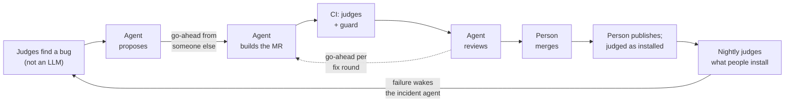

# For judges: polyman on GitLab (Path B · Assisted)

polyman is an MIT command-line tool that people who set programming-contest problems use to check that every solution gets the right verdict. On GitLab, Duo agents maintain it one step at a time: each step waits for a go-ahead from a person who didn't ask for the work, and nothing ships until checks that are neither an LLM nor ours agree it still judges correctly. Every link below opens without logging in. GitLab shows agent session pages only to signed-in members, so three sessions are rendered from the API in the wiki: [#21 from proposal to review](https://gitlab.com/gitlab-ai-hackathon/transcend-october-2026/30770856/showcase/-/wikis/Session-replay-21), [the #45 incident](https://gitlab.com/gitlab-ai-hackathon/transcend-october-2026/30770856/showcase/-/wikis/Session-replay-45), and [a review agent told "REPORT ONLY: do not push" pushing anyway](https://gitlab.com/gitlab-ai-hackathon/transcend-october-2026/30770856/showcase/-/wikis/Session-replay-67).

**Why it matters now:** every problem polyman creates ships instructions for AI coding agents that call `polyman verify` "the bar for 'done'" ([template/instructions/commands/verify.md](https://gitlab.com/gitlab-ai-hackathon/transcend-october-2026/30770856/showcase/-/blob/main/template/instructions/commands/verify.md)) and offer `verify --json` "for agents and scripts". In the release people installed, 3.0.0, that JSON marked tests the checker never judged as `OK` ([#21](https://gitlab.com/gitlab-ai-hackathon/transcend-october-2026/30770856/showcase/-/issues/21)), and `remote push` printed ✓ and exited 0 while uploads failed ([#25](https://gitlab.com/gitlab-ai-hackathon/transcend-october-2026/30770856/showcase/-/issues/25)). The signal agents were told to trust was wrong. So here, every layer that decides something has a judge that isn't an LLM, and every step an agent takes waits for a person who didn't ask.
## 60 seconds

1. [#45](https://gitlab.com/gitlab-ai-hackathon/transcend-october-2026/30770856/showcase/-/issues/45): on Oct 18 at 03:20 UTC an agent opened an incident: the nightly judges had caught the published `polyman-cli@3.0.0` accepting wrong solutions.
2. [#21](https://gitlab.com/gitlab-ai-hackathon/transcend-october-2026/30770856/showcase/-/issues/21): issue-builder's [proposal](https://gitlab.com/gitlab-ai-hackathon/transcend-october-2026/30770856/showcase/-/issues/21#note_4036864596), [Hamza's go-ahead](https://gitlab.com/gitlab-ai-hackathon/transcend-october-2026/30770856/showcase/-/issues/21#note_4037554981) (Ahmed filed it), [!73](https://gitlab.com/gitlab-ai-hackathon/transcend-october-2026/30770856/showcase/-/merge_requests/73) three minutes later, [the guard checking that go-ahead](https://gitlab.com/gitlab-ai-hackathon/transcend-october-2026/30770856/showcase/-/jobs/17264913912), [the review](https://gitlab.com/gitlab-ai-hackathon/transcend-october-2026/30770856/showcase/-/merge_requests/73#note_4037615431), a person's merge.
3. [`release:next-check`](https://gitlab.com/gitlab-ai-hackathon/transcend-october-2026/30770856/showcase/-/jobs/17267989872): both versions installed from npm the way users get them and judged: 3.0.0 matches 0 of 5 problems, 3.0.1 matches 5 of 5. Then a person made 3.0.1 `latest`: [Release v3.0.1](https://gitlab.com/gitlab-ai-hackathon/transcend-october-2026/30770856/showcase/-/releases/v3.0.1).
4. [`autonomy:goahead` on !67](https://gitlab.com/gitlab-ai-hackathon/transcend-october-2026/30770856/showcase/-/jobs/17265270744): the "no" path. A review agent pushed code nobody approved; CI refused it.

## The rules, and where each is met

| Requirement | Where |
|---|---|
| Public project, MIT licence detected by GitLab | this project; [LICENCE](LICENCE) (About: "MIT License") |
| Original MIT project (Path B) | [HamzaHassanain/polyman](https://github.com/HamzaHassanain/polyman), imported at `dcb5779` (3.0.0, Sep 25), tagged [`hackathon-start`](https://gitlab.com/gitlab-ai-hackathon/transcend-october-2026/30770856/showcase/-/tags/hackathon-start) |
| Automation and deployment are new since Oct 5 | everything under [`.gitlab/`](.gitlab), [`engine/`](engine), [`corpus/`](corpus), [`service/`](service), [`sustainability/`](sustainability), `.gitlab-ci.yml`, `.autonomy.yml`; the first GitLab pipeline ran Oct 16 ([Before-After](https://gitlab.com/gitlab-ai-hackathon/transcend-october-2026/30770856/showcase/-/wikis/Before-After)) |
| CI/CD history shows the automation running | [pipelines](https://gitlab.com/gitlab-ai-hackathon/transcend-october-2026/30770856/showcase/-/pipelines); agent sessions run as pipelines with source `duo_workflow` |
| Uses GitLab Duo Agent Platform | four custom flows in [`.gitlab/duo/flows/`](.gitlab/duo/flows) (issue-builder, mr-reviewer, pipeline-fixer, incident-responder), plus GitLab's Code Review flow and Vulnerability Resolution |
| Deployed, public, live | [polyman verify on Cloud Run](https://polyman-verify-ncvkutguda-ue.a.run.app) (`/health`; the first request after idle takes about 20 s: it scales to zero) |
| Google Cloud code in the repository | [`service/deploy/`](service/deploy) (Cloud Run, Workload Identity Federation, egress-denied VPC), [`service/ci/service.gitlab-ci.yml`](service/ci/service.gitlab-ci.yml) |

## By judging criterion

### Technological implementation
- **The bug museum** ([wiki](https://gitlab.com/gitlab-ai-hackathon/transcend-october-2026/30770856/showcase/-/wikis/Bug-museum)): the 8 judge-found bugs planted again on today's code. 3.0.0's 967 unit tests caught none of them, the judges caught all 8, and today's 1268 tests fail on all 8 (7 on a real behaviour check), because each agent fix left a test behind. The script reruns it.
- **Four custom flows on the Duo Agent Platform**, published from the repo, with the project's policy filled in at publish time ([`engine/`](engine)). The go-ahead is enforced in CI, not in a prompt: [`autonomy:goahead`](engine/ci/autonomy.gitlab-ci.yml) reads who pushed each commit and finds the go-ahead note for that push, from someone allowed for the change's risk tier and never the requester. Its code and the policy come from the target branch.
- **Judges that are neither an LLM nor ours**: the corpus (real g++, Java and Python on five original problems with deliberately wrong solutions, judged per test), the round trip (what polyman pushed is read back from the problem platform and compared test by test), mutation testing of the verdict code, toolchain lanes, the service's golden set.
- **Release as a chain of custody**: canary in GitLab's npm registry → npm `next` with provenance → both versions installed and judged → `latest` → GitLab Release with the corpus verdicts, mutation report, SBOM and Sigstore entry.
- **A tamper-evident record**: every accepted agent push and the go-ahead it ran on, chained by SHA-256, rebuilt on every `main` pipeline and published: [ledger](https://showcase-ce2cdc.gitlab.io/ledger/).

### Design: one end-to-end workflow

Judge finds a bug → issue with evidence → agent proposes → someone else's go-ahead → agent builds the MR → CI judges it, the guard checks the go-ahead → review agent reports, each fix round on its own go-ahead → a person merges → a person publishes to `next` → judged as installed → a person makes it `latest` → the nightly judges what people install → a failure wakes incident-responder. It ran for real: [12 loops merged](README.md#what-people-did-per-loop), then [3.0.1](https://gitlab.com/gitlab-ai-hackathon/transcend-october-2026/30770856/showcase/-/releases/v3.0.1) shipped all eight judge-found fixes, 6 h 48 min after the first one merged.

### Potential impact
- **The audience is real**: problem setters who publish to a contest platform, where a wrong verdict means a broken contest. polyman was [announced to them](https://codeforces.com/blog/entry/148803) in November 2025; the first question was whether it can be trusted. About 1,950 npm downloads so far (downloads, not users).
- **The problem was real**: the release people installed (3.0.0) judged deliberately wrong solutions as correct, and matched the true verdicts on 0 of our 5 problems, while all its unit tests passed. The judges found 8 bugs; all are fixed in 3.0.1.
- **The pattern carries over**: any tool whose output people can't check by eye (a linter, a grader, a scanner, a compiler) can be maintained this way: an outside oracle on every change and every night, agents that propose, and a go-ahead from someone who didn't ask. The policy is one file, [`.autonomy.yml`](.autonomy.yml).

### Innovation
**A judge for every judge**, none of them an LLM:
1. polyman judges contestants' solutions;
2. real compilers, the problem platform's own copy, and mutation testing judge polyman (the corpus, the round trip, `corpus:mutation`);
3. a CI guard judges every agent push: no go-ahead from someone who didn't ask, no push ([refused on !67](https://gitlab.com/gitlab-ai-hackathon/transcend-october-2026/30770856/showcase/-/jobs/17265270744));
4. mutation testing judges the guard: of 324 bugs planted in the go-ahead rules, the tests catch 295, 91% ([!128](https://gitlab.com/gitlab-ai-hackathon/transcend-october-2026/30770856/showcase/-/merge_requests/128));
5. a frozen-MR benchmark judges the review agent: the same MRs at the same head, old reviewer against new, scored against findings people later confirmed ([#61](https://gitlab.com/gitlab-ai-hackathon/transcend-october-2026/30770856/showcase/-/issues/61));
6. **a session audit with no model in it judges what the agents actually did**: it reads every Duo session's trace and checkpoint and holds each push against the ledger and the guard. On its first run it found two agent pushes the guard never saw: branches re-created after their MR merged, outside any MR ([!131](https://gitlab.com/gitlab-ai-hackathon/transcend-october-2026/30770856/showcase/-/merge_requests/131), [#64](https://gitlab.com/gitlab-ai-hackathon/transcend-october-2026/30770856/showcase/-/work_items/64));
7. the public ledger lets anyone judge us: every accepted agent push and its go-ahead, chained by SHA-256 ([ledger](https://showcase-ce2cdc.gitlab.io/ledger/)).

Also: **the go-ahead decides who, by risk** (the risk score picks who may approve and how deep the review goes), and **a prompt is not a control**: review specialists told "REPORT ONLY: do not push" pushed six times on Oct 18, and the guard refused each one ([replay](https://gitlab.com/gitlab-ai-hackathon/transcend-october-2026/30770856/showcase/-/wikis/Session-replay-67)).

### Presentation
The video (under 3 minutes) follows one bug from the nightly incident to the release people install, including a refusal. The [README](README.md) has the per-loop table and a claim → evidence table; [Stages](https://gitlab.com/gitlab-ai-hackathon/transcend-october-2026/30770856/showcase/-/wikis/Stages) has every DevSecOps stage with links.

## Special prizes

**Most stages covered**: all nine, each with a run you can open: [Stages](https://gitlab.com/gitlab-ai-hackathon/transcend-october-2026/30770856/showcase/-/wikis/Stages). Plan (judge findings as issues, tracked live in a [GLQL dashboard](https://gitlab.com/gitlab-ai-hackathon/transcend-october-2026/30770856/showcase/-/wikis/Judge-dashboard), Requirements satisfied by CI), Create (issue-builder), Verify (corpus, round trip, mutation), Package (npm canaries, container registry, SBOMs), Secure (SAST and secret detection feeding the risk score, Duo Vulnerability Resolution, a sandboxed service), Release (`next` → judged → `latest`, Release evidence), Configure (`.autonomy.yml`, Workload Identity Federation), Monitor (nightly judges, incidents, automatic rollback), Govern (the go-ahead guard, the ledger).

**Most environmentally impactful**: [SUSTAINABILITY.md](SUSTAINABILITY.md), SCI (ISO/IEC 21031:2024) and SCI for AI, with every model call counted from the sessions' checkpoints ([`sustainability/agent-tokens.json`](sustainability/agent-tokens.json), 232 sessions). What we measured and what we changed because of it:

| Finding | Change | Measured gain |
|---|---|---|
| A carbon number from CI alone misses most of an agent's footprint | count model calls per session, not runner minutes | inference is 76-97% of a review's estimated total |
| Every review got three specialists | review depth follows the risk score | a low-risk review takes about 1/5 of the calls and tokens of a high-risk one |
| A full review read more than it needed | the review cuts of Oct 18 (!100, !102, !105, !116) | about 11 GitLab credits and 1.69M tokens per full review before, about 6 credits and 490k tokens after (median of 9 reviews) |
| Sessions that did nothing useful (stopped early, finished after the merge, repeated a head) | the reviewer checks the MR is still open before it delegates | 73 of 195 reviewer sessions, about 29% of its credits, before; 0 of 19 since |
| Reviewer sessions woke for pipelines that weren't theirs | filter triggers to their own event | 49% of reviewer sessions were wasted wake-ups before the filter (sandbox) |
| Re-reviews of a new head were half of all tokens | re-review only what changed since the last reviewed head (!105) | the reviewer is 94% of all agent tokens, re-reviews half of those |
| Specialists gathered context call by call | fewer, larger lookups (!100, !102) | same MRs, frozen at the same head: 43% fewer calls, 55% fewer tokens (1.28M → 0.57M per review), about the same findings (n=3, [#61](https://gitlab.com/gitlab-ai-hackathon/transcend-october-2026/30770856/showcase/-/issues/61)); at our measured 3.4-27.7 gCO2e per million tokens, about 4.4-35 g → 1.9-16 g per review |
| A wrong change costs a build and its reviews | a person's go-ahead before any build | 2 of 13 proposals were never built |
| What does one accepted change cost? | count every session linked from each fix's issue and MRs | median per shipped fix: 78 model calls, 3.2M tokens, about 22 credits, 13-115 gCO2e; 4-16 credits without a fix round, 74 for #8 with two ([script](https://gitlab.com/gitlab-ai-hackathon/transcend-october-2026/30770856/showcase/-/wikis/tools/fix-cost.py)) |
| A service that idles all day | Cloud Run scales to zero, one request per instance | no instance runs between requests (hence the cold start) |

Anyone can recompute the per-review numbers: `npx -y -p @grnsft/if@1.1.1 if-run -m sustainability/agent-reviews.yml`.

**Google Cloud**: Cloud Run, deployed by CI through Workload Identity Federation (no stored key); a candidate at 0% traffic is checked by the golden set, a person promotes, and a failed production check rolls back by itself ([drill](https://gitlab.com/gitlab-ai-hackathon/transcend-october-2026/30770856/showcase/-/jobs/17264159881) → [Incident #57](https://gitlab.com/gitlab-ai-hackathon/transcend-october-2026/30770856/showcase/-/issues/57)).

## What isn't done, and why
**How to read authorship here.** GitLab shows an agent-built MR as authored by the person who started the agent's session (composite identity), so "author merged their own MR" in the MR list usually means "the person who assigned the agent merged it". The agent is the one that pushed the commits: the guard and the [ledger](https://gitlab.com/gitlab-ai-hackathon/transcend-october-2026/30770856/showcase/-/merge_requests/103) read who pushed from GitLab's push events. The 12 loops include five whose approved commits moved to a second MR after a refused push, which is why the published ledger counts fewer MRs until !103 (moved MRs) is merged. Since Oct 18 evening, a third person merges agent MRs.

In the [README's honest limits](README.md#honest-limits). The short version: we have no Maintainer role, so code-owner approval, protected environments and a pipeline execution policy aren't on (the guard does that job); GitLab Code Review doesn't start when our agent asks for it (DCR4008); a person often merged an MR they had also approved the work for, which the rules allow but is weak separation, so from Oct 18 evening a third person merges.
