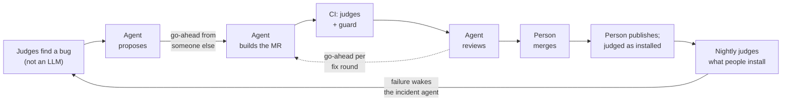

# polyman

**GitLab Transcend · Path B · Assisted.** polyman (`polyman-cli` on npm, MIT) is the command-line tool problem setters on Codeforces and Polygon run before a problem goes out: it compiles every solution, runs it on every test, and checks that each one gets the verdict it should. polyman judges solutions.

**Check it yourself, no login:** [live verify service](https://polyman-verify-ncvkutguda-ue.a.run.app) · [go-ahead ledger](https://showcase-ce2cdc.gitlab.io/ledger/) · [agent carbon](https://showcase-ce2cdc.gitlab.io/sci/) · [Assisted in 60 seconds](JUDGES.md#assisted-in-60-seconds)

**Why it matters:** a wrong verdict from polyman means a broken problem in a live contest round, with wrong expected answers or a bad test that reaches contestants. Real setters use it: contest problems for Repovive and for the ICPC Arab regional (ACPC) were prepared with polyman ([who uses it](#who-uses-it)).

**[57 of 57 loops and 79 of 79 agent pushes](https://gitlab.com/gitlab-ai-hackathon/transcend-october-2026/30770856/showcase/-/jobs/17443329261) ran on a go-ahead from someone other than the requester · [3 people](https://showcase-ce2cdc.gitlab.io/ledger/), and the one who asks never gives the go-ahead · [949 Duo agent sessions](sustainability/agent-tokens.json) · the published 3.0.0 got the expected verdicts on [0 of 5 corpus problems, 3.0.1 on 5 of 5](https://gitlab.com/gitlab-ai-hackathon/transcend-october-2026/30770856/showcase/-/jobs/17267989872).** _Ledger job 25 Oct 01:00 UTC; sessions Oct 16 18:58 to Oct 25 00:32 UTC; release check Oct 18._

**Original project (MIT):** https://github.com/HamzaHassanain/polyman · **Our project:** https://gitlab.com/gitlab-ai-hackathon/transcend-october-2026/30770856/showcase · **Live:** https://polyman-verify-ncvkutguda-ue.a.run.app · **For judges:** [JUDGES.md](https://gitlab.com/gitlab-ai-hackathon/transcend-october-2026/30770856/showcase/-/blob/main/JUDGES.md)

**So what judges polyman?** Programs, not a model: real compilers on a corpus of real problems, and mutation testing that grades polyman's own tests. A new version reaches npm `latest` only if it judges that corpus at least as well as the last release. On Oct 18 the published 3.0.0 got the expected verdicts on 0 of 5 problems and 3.0.1 on 5 of 5 ([job](https://gitlab.com/gitlab-ai-hackathon/transcend-october-2026/30770856/showcase/-/jobs/17267989872)); only then did a person move `latest`.

**A person approves every step.** Duo agents turn what the judges find into proposed fixes. A teammate who didn't ask for the work gives the go-ahead, and the CI guard `autonomy:goahead` fails any agent push without one.

<!-- Video (under 3 minutes): put its link here, once it is published. -->

## GitLab Transcend: Life After Code (Path B · Assisted)

Polyman ([`polyman-cli` on npm](https://www.npmjs.com/package/polyman-cli)) is a CLI that helps Codeforces problem setters build, test and verify problems. On GitLab, Duo agents turn bugs found by the judges (real compilers, not a model) into fixes, review every MR at a depth set by its risk, and open an incident when production fails its check. An agent builds or pushes only after a go-ahead from a person who did not ask for the work, and the CI job `autonomy:goahead` fails any agent push without one, judged from GitLab's own records of who wrote which note and who pushed what, and when. Live service: [polyman-verify on Cloud Run](https://polyman-verify-ncvkutguda-ue.a.run.app).

In the roles problem setters already know: issue-builder is the author, the judges are the testers, mr-reviewer is the coordinator, and the person who gives the go-ahead is the chief judge.

**New here?** [Start here](#start-here-from-an-issue-to-production): one change from an issue to production, and who acts at each step.

- **The go-ahead never came from the person who asked: 57 of 57 loops**, and since the guard reached `main` on 17 Oct 20:11 it refused 9 agent pushes on 8 MRs (8 without a go-ahead, 1 changing files only people may change, 1 breaking another rule; one push on !241 broke two rules). *([ledger job 17443329261](https://gitlab.com/gitlab-ai-hackathon/transcend-october-2026/30770856/showcase/-/jobs/17443329261), 25 Oct 01:00 UTC; the rules: [`engine/src/goahead.ts`](https://gitlab.com/gitlab-ai-hackathon/transcend-october-2026/30770856/showcase/-/blob/bc8597bed80372d9bc97e9578cbfe654c15d4120/engine/src/goahead.ts#L205))*
- **A bad change reached production, was rolled back automatically in 94 s, and became two checks that refuse the same bug before merge.** *([promote](https://gitlab.com/gitlab-ai-hackathon/transcend-october-2026/30770856/showcase/-/jobs/17285820678) and [rollback](https://gitlab.com/gitlab-ai-hackathon/transcend-october-2026/30770856/showcase/-/jobs/17285820680) job logs; [!163](https://gitlab.com/gitlab-ai-hackathon/transcend-october-2026/30770856/showcase/-/merge_requests/163))*
- **The reviewer on `main` found 13 of 17 earlier P1/P2 findings at P1/P2 in each of two runs on our frozen 5-MR benchmark; the version before it (1.0.32) found 7 of 17, twice.** On two MRs it was not tuned on it found 4 of 5. It costs a median of about 8 credits per review (7.8 and 8.1 in the two runs), against 6.7 for the second 1.0.32 run, because its specialists run the MR's code. *(Oct 24; each finding read against the original review notes and checked on the copy's code, the scoring checked a second time, the one disputed rating decided by a maintainer; [SUSTAINABILITY.md](SUSTAINABILITY.md#the-reviewer-on-main-e-b35-two-runs-oct-24))*

**The nine stages at a glance** (each link opens without logging in; the table after it has who decided and the full story):

| Stage | GitLab feature our automation uses | Latest event |
|---|---|---|
| Plan | Issues and issue templates; Duo flows started from an issue | [issue-builder's proposal on #116](https://gitlab.com/gitlab-ai-hackathon/transcend-october-2026/30770856/showcase/-/issues/116#note_4082377392), 24 Oct |
| Create | Merge requests built by Duo flows | [!330](https://gitlab.com/gitlab-ai-hackathon/transcend-october-2026/30770856/showcase/-/merge_requests/330), merged 24 Oct |
| Verify | CI pipelines on Linux runners; on every `main` pipeline also macOS (the corpus) and Windows (the unit tests), started by hand on MRs; "Pipelines must succeed". 25 Oct on `main`: [macOS](https://gitlab.com/gitlab-ai-hackathon/transcend-october-2026/30770856/showcase/-/jobs/17444838687) 5 of 5 problems, [Windows](https://gitlab.com/gitlab-ai-hackathon/transcend-october-2026/30770856/showcase/-/jobs/17444838688) 2,694 tests passed, 62 skipped | [nightly pipeline](https://gitlab.com/gitlab-ai-hackathon/transcend-october-2026/30770856/showcase/-/pipelines/2983748171), 24 Oct 03:07 |
| Package | This project's npm, generic and container registries | [Packages](https://gitlab.com/gitlab-ai-hackathon/transcend-october-2026/30770856/showcase/-/packages) |
| Secure | SAST, Secret Detection, Dependency Scanning and IaC scanning, every night | [IaC scan in the nightly](https://gitlab.com/gitlab-ai-hackathon/transcend-october-2026/30770856/showcase/-/jobs/17433748335), 24 Oct; [triage](https://gitlab.com/gitlab-ai-hackathon/transcend-october-2026/30770856/showcase/-/issues/20#note_4059866508) |
| Release | GitLab Releases, environments and deployments | [Release v3.1.0](https://gitlab.com/gitlab-ai-hackathon/transcend-october-2026/30770856/showcase/-/releases/v3.1.0), 25 Oct 02:17 |
| Configure | GitLab-managed OpenTofu state; `infra:plan` drift check every night | [`infra:plan` in the nightly](https://gitlab.com/gitlab-ai-hackathon/transcend-october-2026/30770856/showcase/-/jobs/17433748337), 24 Oct |
| Monitor | Incident management; automatic rollback | [Incident #65](https://gitlab.com/gitlab-ai-hackathon/transcend-october-2026/30770856/showcase/-/issues/65) and [rollback](https://gitlab.com/gitlab-ai-hackathon/transcend-october-2026/30770856/showcase/-/jobs/17285820680), 19 Oct |
| Govern | Release evidence; vulnerability management | [v3.1.0 evidence](https://gitlab.com/gitlab-ai-hackathon/transcend-october-2026/30770856/showcase/-/releases/v3.1.0/evidences/25492827.json), 25 Oct |

| Stage | What ran on GitLab | Who decided | One link |
|---|---|---|---|
| Plan | 16 Oct 14:08: Ahmed filed #22, a bug the judges found (Python solutions judged Runtime Error where there is no `python` command). 17 Oct 20:56: issue-builder posted a proposal and waited. | Ahmed filed it; Mazen gave the go-ahead (17 Oct 22:09) | [proposal on #22](https://gitlab.com/gitlab-ai-hackathon/transcend-october-2026/30770856/showcase/-/issues/22#note_4035973201) |
| Create | issue-builder built the fix as !26 after that go-ahead; the guard matched its push to the go-ahead note. Merged 51 min after the go-ahead. | Ahmed merged | [!26](https://gitlab.com/gitlab-ai-hackathon/transcend-october-2026/30770856/showcase/-/merge_requests/26) |
| Verify | Each MR gets a risk score that sets the review depth: the lead reviewer alone at low risk, three specialist reviewers at high. On 18 Oct `autonomy:goahead` failed a reviewer's push to !67 that had no go-ahead. | The guard, from GitLab's records ([`engine/src/goahead.ts`](https://gitlab.com/gitlab-ai-hackathon/transcend-october-2026/30770856/showcase/-/blob/bc8597bed80372d9bc97e9578cbfe654c15d4120/engine/src/goahead.ts#L205)) | [refused push on !67](https://gitlab.com/gitlab-ai-hackathon/transcend-october-2026/30770856/showcase/-/jobs/17265270744) |
| Package | GitLab's registries first. Package registry (npm): `canary:publish` put `@gitlab-ai-hackathon/polyman-cli` 3.1.0-canary.2217 in this project's npm registry on 25 Oct 01:56 (7 canaries since 18 Oct). Container registry: `service:image` pushed the verify service image `registry.gitlab.com/gitlab-ai-hackathon/transcend-october-2026/30770856/showcase/verify:0ae6af3c` on 20 Oct 17:14. Package registry (generic): `release:evidence` keeps each release's evidence (corpus verdicts, mutation report, SBOM, npm attestation) as `polyman-cli-evidence` 3.0.1, 3.0.2, 3.0.3 and 3.1.0. Then npm: `release:npm-next` published `polyman-cli` 3.0.1 (18 Oct 19:25), 3.0.2 (20 Oct 20:07), 3.0.3 (21 Oct 16:49) and 3.1.0 (25 Oct 02:01) to `next` with provenance, and each went to `latest` only after it was judged (Release). | Hamza ran the 3.0.2 and 3.0.3 canaries and the first three npm publish jobs; Ahmed ran 3.1.0's canary and npm publish; the image push and the evidence upload run on their own | [packages](https://gitlab.com/gitlab-ai-hackathon/transcend-october-2026/30770856/showcase/-/packages) ([canary job](https://gitlab.com/gitlab-ai-hackathon/transcend-october-2026/30770856/showcase/-/jobs/17354770601), [evidence job](https://gitlab.com/gitlab-ai-hackathon/transcend-october-2026/30770856/showcase/-/jobs/17354770606)), [container registry](https://gitlab.com/gitlab-ai-hackathon/transcend-october-2026/30770856/showcase/container_registry/12643880) ([`service:image`](https://gitlab.com/gitlab-ai-hackathon/transcend-october-2026/30770856/showcase/-/jobs/17324813603)), npm `next`: [3.0.1](https://gitlab.com/gitlab-ai-hackathon/transcend-october-2026/30770856/showcase/-/jobs/17267922095), [3.0.2](https://gitlab.com/gitlab-ai-hackathon/transcend-october-2026/30770856/showcase/-/jobs/17324813615), [3.0.3](https://gitlab.com/gitlab-ai-hackathon/transcend-october-2026/30770856/showcase/-/jobs/17354770603), [3.1.0](https://gitlab.com/gitlab-ai-hackathon/transcend-october-2026/30770856/showcase/-/jobs/17443607242) |
| Secure | 18 Oct: the 349 scanner findings were triaged in #20; one was real (`remote push` could upload any path named in Config.json). It became #62, issue-builder built !136, merged 19 Oct 16:40. | Mazen filed #62; Ahmed gave the go-ahead and merged | [#62](https://gitlab.com/gitlab-ai-hackathon/transcend-october-2026/30770856/showcase/-/issues/62) |
| Release | 18 Oct: `release:next-check` installed 3.0.0 and 3.0.1 the way users get them and judged both: 3.0.0 matched 0 of 5 problems, 3.0.1 matched 5 of 5, Polygon round trip 34/34. Only then did 3.0.1 go to `latest`. 20 Oct: 3.0.2 against 3.0.1: both matched 4 of 5 (one problem's compile step hit its 10 s limit on both), no regression, round trip 34/34 ([job](https://gitlab.com/gitlab-ai-hackathon/transcend-october-2026/30770856/showcase/-/jobs/17329270197)); 3.0.2 went to `latest` at 20:22. A first run, before npm served 3.0.2, could not install it and refused. 21 Oct: 3.0.3 against 3.0.2 the same way: 3.0.3 matched 5 of 5 and 3.0.2 4 of 5, no regression, round trip 34/34 ([job](https://gitlab.com/gitlab-ai-hackathon/transcend-october-2026/30770856/showcase/-/jobs/17354770604)); 3.0.3 went to `latest` at 17:09. 25 Oct: 3.1.0 against 3.0.3: both matched 5 of 5, no regression, round trip 34/34 ([job](https://gitlab.com/gitlab-ai-hackathon/transcend-october-2026/30770856/showcase/-/jobs/17443872107)); 3.1.0 went to `latest` at 02:16. A first run, at 02:09, failed because npm did not serve 3.1.0 yet ("No matching version found") ([job](https://gitlab.com/gitlab-ai-hackathon/transcend-october-2026/30770856/showcase/-/jobs/17443607243)); the rerun passed. Production service: 19 Oct drill, !127, a change with a planted bug, passed its Cloud Run candidate check and was promoted to production at 13:44:56 (the Cloud Run promote is the service's release step). Each step is a deployment to a GitLab environment: `canary`, `npm-next` and `npm-latest` for the package, `verify/production` for the service. | Mazen clicked `release:promote` for 3.0.1, Hamza for 3.0.2 and 3.0.3, Ahmed for 3.1.0; Mazen promoted the 19 Oct Cloud Run drill | [Release v3.1.0](https://gitlab.com/gitlab-ai-hackathon/transcend-october-2026/30770856/showcase/-/releases/v3.1.0) ([v3.0.3](https://gitlab.com/gitlab-ai-hackathon/transcend-october-2026/30770856/showcase/-/releases/v3.0.3), [v3.0.2](https://gitlab.com/gitlab-ai-hackathon/transcend-october-2026/30770856/showcase/-/releases/v3.0.2), [v3.0.1](https://gitlab.com/gitlab-ai-hackathon/transcend-october-2026/30770856/showcase/-/releases/v3.0.1); the gate: [`.gitlab/ci/release.gitlab-ci.yml`](https://gitlab.com/gitlab-ai-hackathon/transcend-october-2026/30770856/showcase/-/blob/bc8597bed80372d9bc97e9578cbfe654c15d4120/.gitlab/ci/release.gitlab-ci.yml#L59)), [Cloud Run promote](https://gitlab.com/gitlab-ai-hackathon/transcend-october-2026/30770856/showcase/-/jobs/17285820678) |
| Configure | 20 Oct: OpenTofu in `infra/`, its state kept in GitLab-managed OpenTofu state (`verify`), describes the verify sandbox on Google Cloud (21 resources: isolated network with egress denied, gVisor, the deploy identity). `infra:import` adopted all 21 and reported "No changes"; `infra:plan` on `main` is the drift check and also judges the plan against fixed rules. | Mazen merged [!179](https://gitlab.com/gitlab-ai-hackathon/transcend-october-2026/30770856/showcase/-/merge_requests/179); Ahmed ran `infra:import` | [`infra:import`](https://gitlab.com/gitlab-ai-hackathon/transcend-october-2026/30770856/showcase/-/jobs/17327387467) |
| Monitor | GitLab incident management: [Incident #65](https://gitlab.com/gitlab-ai-hackathon/transcend-october-2026/30770856/showcase/-/issues/65), opened by incident-responder, with a severity and a timeline. After the 19 Oct drill promote (Release), the production check read the review's watch list and failed (both watched POST routes at 100% errors, limit 5%; GET /api/samples stayed at 0%). The rollback finished at 13:46:30 without waiting for anyone. incident-responder opened Incident #65 at 14:04 with the cause. | Nobody: check and rollback are automatic (a fixed CI safety net we wrote, not an agent) | [Incident #65](https://gitlab.com/gitlab-ai-hackathon/transcend-october-2026/30770856/showcase/-/issues/65) |
| Govern | GitLab's release evidence and vulnerability management. When each release was created, GitLab took a snapshot of its evidence, with a SHA it records: the release pipeline's report artifacts and the evidence package ([v3.1.0's evidence](https://gitlab.com/gitlab-ai-hackathon/transcend-october-2026/30770856/showcase/-/releases/v3.1.0/evidences/25492827.json), [v3.0.3](https://gitlab.com/gitlab-ai-hackathon/transcend-october-2026/30770856/showcase/-/releases/v3.0.3/evidences/25380835.json), [v3.0.2](https://gitlab.com/gitlab-ai-hackathon/transcend-october-2026/30770856/showcase/-/releases/v3.0.2/evidences/25344087.json), [v3.0.1](https://gitlab.com/gitlab-ai-hackathon/transcend-october-2026/30770856/showcase/-/releases/v3.0.1)). Every finding in the vulnerability report was triaged by hand on [#20](https://gitlab.com/gitlab-ai-hackathon/transcend-october-2026/30770856/showcase/-/issues/20#note_4038481944) (18 Oct, [addendum](https://gitlab.com/gitlab-ai-hackathon/transcend-october-2026/30770856/showcase/-/issues/20#note_4059866508) 21 Oct); the one real finding was fixed through an agent loop ([#62](https://gitlab.com/gitlab-ai-hackathon/transcend-october-2026/30770856/showcase/-/work_items/62) → [!136](https://gitlab.com/gitlab-ai-hackathon/transcend-october-2026/30770856/showcase/-/merge_requests/136)), and Duo's Vulnerability Resolution proposed a fix a person reviewed ([!57](https://gitlab.com/gitlab-ai-hackathon/transcend-october-2026/30770856/showcase/-/merge_requests/57)). On top of these, our guard: the rollback MR !137 needed a maintainer's go-ahead and recorded a +25 risk lesson for `service/src/app.ts`. At 15:24 the lesson raised the next change to that file (!143) to high risk, 60 (35 without it). At 21:29-21:32 a rehearsal MR (!163) put the #65 bug back: `service:test` and `service:golden` both failed before merge. | Mazen triaged the findings, Ahmed the addendum; Mazen gave the go-ahead for !137 and Ahmed merged it; the risk score and the checks did the rest (the lesson: [`engine/src/risk.ts`](https://gitlab.com/gitlab-ai-hackathon/transcend-october-2026/30770856/showcase/-/blob/bc8597bed80372d9bc97e9578cbfe654c15d4120/engine/src/risk.ts#L151)) | [triage on #20](https://gitlab.com/gitlab-ai-hackathon/transcend-october-2026/30770856/showcase/-/issues/20#note_4038481944), [release evidence](https://gitlab.com/gitlab-ai-hackathon/transcend-october-2026/30770856/showcase/-/releases/v3.1.0/evidences/25492827.json), [rehearsal !163](https://gitlab.com/gitlab-ai-hackathon/transcend-october-2026/30770856/showcase/-/merge_requests/163) |

Times are UTC, from the linked job logs and GitLab's MR and issue records. Plan: [go-ahead note](https://gitlab.com/gitlab-ai-hackathon/transcend-october-2026/30770856/showcase/-/issues/22#note_4036138042). Configure: `infra:import` logged "Plan: 21 to import, 0 to add, 0 to change, 0 to destroy.", then "No changes. The GitLab state matches Google Cloud." (19:50); the latest `infra:plan` on `main`, [job 17329028604](https://gitlab.com/gitlab-ai-hackathon/transcend-october-2026/30770856/showcase/-/jobs/17329028604), logged "no drift" (20:07). Monitor: [production check](https://gitlab.com/gitlab-ai-hackathon/transcend-october-2026/30770856/showcase/-/jobs/17285820679), [rollback](https://gitlab.com/gitlab-ai-hackathon/transcend-october-2026/30770856/showcase/-/jobs/17285820680). Secure: 349 is the count in [#20's triage note](https://gitlab.com/gitlab-ai-hackathon/transcend-october-2026/30770856/showcase/-/issues/20#note_4038481944). The publish and promote jobs are manual on purpose: a "blocked" deployment on the environments page is a step nobody chose to take.

**Added on 20 Oct**

- **Plan:** issue templates for a verdict dispute, a field report and a judge finding, an MR template for an agent-built fix, and an Insights report of what the judges found per week ([!176](https://gitlab.com/gitlab-ai-hackathon/transcend-october-2026/30770856/showcase/-/merge_requests/176)).
- **Verify:** the corpus also runs on GitLab's macOS runner; its first run on `main` [matched 5 of 5 problems](https://gitlab.com/gitlab-ai-hackathon/transcend-october-2026/30770856/showcase/-/jobs/17317694352) ([!180](https://gitlab.com/gitlab-ai-hackathon/transcend-october-2026/30770856/showcase/-/merge_requests/180)).
- **Adopt:** the four flows (issue-builder, mr-reviewer, pipeline-fixer, incident-responder) are public in the GitLab AI Catalog; [Adopt our flows](https://gitlab.com/gitlab-ai-hackathon/transcend-october-2026/30770856/showcase/-/wikis/Adopt-our-flows) says how to use them in another project. *Checked logged out on 20 Oct: GitLab's GraphQL API lists all four as public.*

**Results so far**

- **The go-ahead never came from the person who asked: 57 of 57 loops, 79 of 79 agent pushes.** 57 loops were merged by a person (37 changes built by issue-builder, 18 reviewer fix rounds on people's MRs, 1 pipeline fix, 1 incident rollback, per the ledger's [loops.json](https://showcase-ce2cdc.gitlab.io/ledger/loops.json)): 12 on 17-18 Oct, 9 on 19 Oct, 6 on 20 Oct, 5 on 21 Oct, 5 on 22 Oct, 7 on 23 Oct and 13 on 24 Oct (to 23:29 UTC). `autonomy:goahead` refused 9 agent pushes on 8 MRs since the guard reached `main` on 17 Oct 20:11: 7 on 18 Oct for no go-ahead, 1 on 20 Oct on !177 for changing files only people may change, and 1 on 22 Oct on !241, a merge commit pushed with no proposal before it (one push that broke two rules). *Counted by the [ledger job](https://gitlab.com/gitlab-ai-hackathon/transcend-october-2026/30770856/showcase/-/jobs/17443329261) (shown on the [ledger page](https://showcase-ce2cdc.gitlab.io/ledger/)), which rebuilds every loop from GitLab's note and push records; run on `main` 25 Oct, 01:00 UTC. Merge dates are GitLab's MR merge times (UTC), as in the ledger's [loops.json](https://showcase-ce2cdc.gitlab.io/ledger/loops.json); its `refusedPushes` (6) counts only the refused pushes on loops that merged, so it leaves out !90, !177 and !241, which never merged. Code: [`engine/src/ledger.ts`](https://gitlab.com/gitlab-ai-hackathon/transcend-october-2026/30770856/showcase/-/blob/bc8597bed80372d9bc97e9578cbfe654c15d4120/engine/src/ledger.ts#L212), the go-ahead rules in [`engine/src/goahead.ts`](https://gitlab.com/gitlab-ai-hackathon/transcend-october-2026/30770856/showcase/-/blob/bc8597bed80372d9bc97e9578cbfe654c15d4120/engine/src/goahead.ts#L205).*
- **On the same diffs, the reviewer on `main` takes about 40% fewer credits than the original full reviews and finds 13 of their 17 P1/P2 findings.** Five earlier MRs, frozen at the heads of their first reviews, reviewed again on identical diffs: a median of 13.1 credits per review for the original reviews, 7.8 and 8.1 in two runs of the reviewer on `main` (Oct 24), with 13 of 17 found at P1/P2 in each run and no false P1. On the way there, reviewer 1.0.25 cost about half (5.8 credits, 4.0-31.1 against 8.4-70.0 gCO2e) but found 11 of 17, and 1.0.32 found 7 of 17 in two runs. Three rules that missed a bar written down before they ran were dropped: E-R found 9 of 17 and was reverted in [!182](https://gitlab.com/gitlab-ai-hackathon/transcend-october-2026/30770856/showcase/-/merge_requests/182), E-R2 found 12 of 18 on five MRs it was never tuned on (bar 15) and was reverted in [!234](https://gitlab.com/gitlab-ai-hackathon/transcend-october-2026/30770856/showcase/-/merge_requests/234), and E-B34 found 13 of 17 with too many false or overrated findings, so it was not merged. *Calls counted from each session's checkpoints, credits as calls / 3.6, findings read against the P1/P2 list in each original review note; n=5, two runs for the reviewer on `main` and for 1.0.32, one run for the others. Details in [SUSTAINABILITY.md](SUSTAINABILITY.md#the-reviewer-on-main-e-b35-two-runs-oct-24).*
- **An incident became a check.** Production served the bad change for 94 seconds (promote finished 13:44:56, rollback finished 13:46:30 UTC, 19 Oct); the same bug, put back in !163, was refused by two checks before merge. *Read from the [rollback](https://gitlab.com/gitlab-ai-hackathon/transcend-october-2026/30770856/showcase/-/jobs/17285820680), [`service:golden`](https://gitlab.com/gitlab-ai-hackathon/transcend-october-2026/30770856/showcase/-/jobs/17298966362) and [`service:test`](https://gitlab.com/gitlab-ai-hackathon/transcend-october-2026/30770856/showcase/-/jobs/17298966353) job logs.*

**More:** [Start here](#start-here-from-an-issue-to-production) · [JUDGES.md](JUDGES.md) (evidence by judging criterion) · [SUSTAINABILITY.md](SUSTAINABILITY.md) (what the agents cost) · [Go-ahead ledger](https://showcase-ce2cdc.gitlab.io/ledger/) · [Stages wiki](https://gitlab.com/gitlab-ai-hackathon/transcend-october-2026/30770856/showcase/-/wikis/Stages) · release: [`polyman-cli` 3.1.0 on npm](https://www.npmjs.com/package/polyman-cli/v/3.1.0) (npm `latest` since 25 Oct 02:16 UTC; [Release v3.1.0](https://gitlab.com/gitlab-ai-hackathon/transcend-october-2026/30770856/showcase/-/releases/v3.1.0)) · original repository: [HamzaHassanain/polyman](https://github.com/HamzaHassanain/polyman), imported at [`dcb5779`](https://github.com/HamzaHassanain/polyman/commit/dcb5779705da91bc898cc456a0d96bd5d311cf41) ("release: 3.0.0", 2026-09-25), tagged `hackathon-start` here.

### Environmental: measured before and after, with the bar written down first

| Change | Bar set before | Before → after | Same output? |
|---|---|---|---|
| The reviewer on `main` ([!336](https://gitlab.com/gitlab-ai-hackathon/transcend-october-2026/30770856/showcase/-/merge_requests/336)) | ✔ | 7 of 17 (reviewer 1.0.32, two runs) → 13 of 17 original P1/P2 findings in each of two runs; 7.8 and 8.1 credits per review against 13.1 for the original reviews | no false P1; held-out MRs 4 of 5 |
| CI mutation survivors ([!237](https://gitlab.com/gitlab-ai-hackathon/transcend-october-2026/30770856/showcase/-/merge_requests/237)) | ✔ | 185.1 → 65.2 runner-minutes per pipeline (-64.8%) | 116 of 116 mutant outcomes identical |
| The verify service ([!248](https://gitlab.com/gitlab-ai-hackathon/transcend-october-2026/30770856/showcase/-/merge_requests/248)) | measured, no prior bar | -57.4% CPU per verify; candidate check 18.3 → 9.4 s | 90 of 90 verifies byte-identical |
| The CLI's precompiled header in 3.1.0 ([!282](https://gitlab.com/gitlab-ai-hackathon/transcend-october-2026/30770856/showcase/-/merge_requests/282)) | ✔ | -28% CPU per cold verify, -18% per edit-and-reverify | identical in all 65 runs |
| Rejected: E-R ([!182](https://gitlab.com/gitlab-ai-hackathon/transcend-october-2026/30770856/showcase/-/merge_requests/182)), E-R2 ([!234](https://gitlab.com/gitlab-ai-hackathon/transcend-october-2026/30770856/showcase/-/merge_requests/234)), E-B34 | ✔ | each missed its bar | not on `main` |

Every MR pipeline also reports its own runner-minutes and gCO2e in the MR's metrics widget, next to `main`'s ([!330](https://gitlab.com/gitlab-ai-hackathon/transcend-october-2026/30770856/showcase/-/merge_requests/330); MR pipelines run fewer jobs, so the gap is not a saving). How each row was measured, and the grams per merged change: [SUSTAINABILITY.md](SUSTAINABILITY.md#measured-before-and-after-with-the-bar-written-down-first).

### Impact, measured

- **From a bug to a fix: months before, minutes and hours now.** On GitHub, two bugs users reported waited 230 days ([#17](https://github.com/HamzaHassanain/polyman/issues/17)) and 175 days ([#19](https://github.com/HamzaHassanain/polyman/issues/19)) from the report to a release with the fix (issue and npm release dates, read 17 Oct). Here, the first five agent loops took 12 to 51 minutes from the go-ahead to the merge (17-18 Oct, n=5; over all 57 loops the median is 3 h 50 min; go-ahead note and merge times from GitLab's records, as in the [ledger job](https://gitlab.com/gitlab-ai-hackathon/transcend-october-2026/30770856/showcase/-/jobs/17443329261)), and the eight bugs the judges found reached npm `latest` in 3.0.1 21 h after the first of the eight fixes merged ([Release v3.0.1](https://gitlab.com/gitlab-ai-hackathon/transcend-october-2026/30770856/showcase/-/releases/v3.0.1)). The spans differ: before is report to release, after is go-ahead to merge and first fix to release.
- **A field report from a problem setter outside the team ([#106](https://gitlab.com/gitlab-ai-hackathon/transcend-october-2026/30770856/showcase/-/work_items/106), 22 Oct).** He prepares about 20-25 contest problems a year and ran polyman 3.0.3 on the three problems with content in his own Polygon account, on his own machine. On the one that ran end to end, polyman and Polygon agreed on all 22 tests, a cold `verify` took 36.5 s (17.0 s warm), and it caught 3 of the 4 planted bugs that applied; the one it missed, a validator that accepts anything, got through because the problem had no validator self-tests. He puts his own check by hand at about 30 minutes a problem (his estimate). The report became four issues, all fixed in 3.1.0: [#108](https://gitlab.com/gitlab-ai-hackathon/transcend-october-2026/30770856/showcase/-/work_items/108), [#110](https://gitlab.com/gitlab-ai-hackathon/transcend-october-2026/30770856/showcase/-/work_items/110) and [#111](https://gitlab.com/gitlab-ai-hackathon/transcend-october-2026/30770856/showcase/-/work_items/111) by agent loops on 23 Oct (!263, !264, !265), [#109](https://gitlab.com/gitlab-ai-hackathon/transcend-october-2026/30770856/showcase/-/work_items/109) by !308. His verdict dispute, [#107](https://gitlab.com/gitlab-ai-hackathon/transcend-october-2026/30770856/showcase/-/work_items/107) (OK on Polygon, Presentation Error on polyman), is still open.
- **The same loop on a second codebase.** On 21 Oct our issue-builder and mr-reviewer flows, published to another project of ours (a small orders API, nothing to do with contests), ran one change end to end: [issue #3](https://gitlab.com/gitlab-ai-hackathon/transcend-october-2026/25292121/autonomy-sandbox/-/work_items/3), a proposal, a go-ahead from someone who didn't file it, [MR !20](https://gitlab.com/gitlab-ai-hackathon/transcend-october-2026/25292121/autonomy-sandbox/-/merge_requests/20), a review ("ready to approve") and a person's merge at 17:36 UTC. Before that, the builder [declined](https://gitlab.com/gitlab-ai-hackathon/transcend-october-2026/25292121/autonomy-sandbox/-/work_items/3#note_4060147436) to build from the issue because the person who filed it wasn't on that project's list. One change on one other project: it shows the setup carries over, not that it fits every project.

### Start here: from an issue to production

One change, start to finish. Each step says who acts and where GitLab tells them what comes next.

1. **File an issue** that says when it is done ("Done when: ..."), and assign it to the issue builder (`ai-issue-builder-gitlab-ai-hackathon_e1c791`). You act; the builder answers on the issue with a proposal.
2. **Give the go-ahead.** Someone who didn't file the issue replies with the exact line the proposal shows, `@<agent> go-ahead`, on a line of its own (a maintainer, if the proposal says so). The proposal names who may.
3. **The builder opens the MR.** Its comment on the issue links the MR and ends with a "Next:" line that names who mentions `@ai-mr-reviewer-gitlab-ai-hackathon_e50080` on the MR once the pipeline passes.
4. **Read each review.** It either names who merges (its "Merge" line: that maintainer approves and merges) or proposes fixes, and each fix round needs its own go-ahead.
5. **After a merge that touches the service,** the person who merged opens the merge's pipeline. The last line of `service:check:candidate` names them and links the job: `NEXT STEP: ... To release it, @user (who merged !N) runs service:promote:production: <link>`. That person clicks it. If the line says a newer main pipeline exists, they promote that pipeline's candidate instead.
6. **The production check and the rollback run by themselves.** If one fails, an incident opens and the responder's notes say who acts next.

From here on, every step a person takes is announced in GitLab: read the newest note from an agent or the last lines of the job log. When something doesn't go as above, see [What to do when...](#what-to-do-when).


### Check it yourself: no login, 60 seconds

1. **[!5][mr5]: one wrong line, all unit tests green, the judge says no.** The demo makes the wrong-answer rule also accept `OK`. In [this pipeline](https://gitlab.com/gitlab-ai-hackathon/transcend-october-2026/30770856/showcase/-/pipelines/2959006759) all 974 unit tests pass on Node 20 and 22, and the verify service's golden set [fails on the `wrong-tag` sample, and only there](https://gitlab.com/gitlab-ai-hackathon/transcend-october-2026/30770856/showcase/-/jobs/17258296779).
2. **[#45][i45]: the nightly judges caught the published `polyman-cli@3.0.0` misjudging.** No one asked for it: incident-responder runs when a pipeline on `main` fails, and it opened #45 a minute after the [scheduled run](https://gitlab.com/gitlab-ai-hackathon/transcend-october-2026/30770856/showcase/-/pipelines/2959571332) went red.
3. **[#22][i22] → [!26][mr26]: one full Assisted loop.** issue-builder's [proposal](https://gitlab.com/gitlab-ai-hackathon/transcend-october-2026/30770856/showcase/-/issues/22#note_4035973201), [Mazen's go-ahead](https://gitlab.com/gitlab-ai-hackathon/transcend-october-2026/30770856/showcase/-/issues/22#note_4036138042) (Ahmed filed #22), the MR, the [guard accepting it](https://gitlab.com/gitlab-ai-hackathon/transcend-october-2026/30770856/showcase/-/jobs/17259651990), the [review](https://gitlab.com/gitlab-ai-hackathon/transcend-october-2026/30770856/showcase/-/merge_requests/26#note_4036237877), and a person's merge.

### October 18, 03:09 UTC: the judges catch the release people install

Every night a [schedule](https://gitlab.com/gitlab-ai-hackathon/transcend-october-2026/30770856/showcase/-/pipeline_schedules) runs the corpus and the Polygon round trip against `polyman-cli@latest` from npm. On October 18 [`corpus:production`](https://gitlab.com/gitlab-ai-hackathon/transcend-october-2026/30770856/showcase/-/jobs/17261412692) failed: 3.0.0 judged deliberately wrong solutions `OK` on tests the checker never judged, and reported a presentation error as `WA`. incident-responder opened [#45][i45] at 03:20 and mapped each failure to the bug behind it ([#21][i21], [#28][i28]). It also noticed that #21 was closed while `main` still failed.

A person checked each point the same morning. #21 had been closed by mistake (by the MR that added the corpus that detects it), so it was reopened. The round-trip error got an HTTP-status log ([!48][mr48]), and the next run showed the cause: Polygon answering HTTP 502 and 524, errors on its side ([note](https://gitlab.com/gitlab-ai-hackathon/transcend-october-2026/30770856/showcase/-/issues/45#note_4036911018)). issue-builder proposed fixes for [#21](https://gitlab.com/gitlab-ai-hackathon/transcend-october-2026/30770856/showcase/-/issues/21#note_4036864596) and [#28](https://gitlab.com/gitlab-ai-hackathon/transcend-october-2026/30770856/showcase/-/issues/28#note_4036156918). [Hamza](https://gitlab.com/gitlab-ai-hackathon/transcend-october-2026/30770856/showcase/-/issues/21#note_4037554981) and [Mazen](https://gitlab.com/gitlab-ai-hackathon/transcend-october-2026/30770856/showcase/-/issues/28#note_4037716388) gave the go-aheads; neither had filed them. By 15:18 UTC all six bugs the judges had found were fixed on `main` by agent loops (table below).

At 19:26 Hamza published 3.0.1 to npm `next`. [`release:next-check`](https://gitlab.com/gitlab-ai-hackathon/transcend-october-2026/30770856/showcase/-/jobs/17267989872) installed both versions as users get them and judged them: **3.0.0 matched 0 of 5 problems, 3.0.1 matched 5 of 5**, the Polygon round trip on 3.0.1 passed 34/34, and nothing regressed. At 19:59 Mazen promoted it to `latest`, and the [GitLab Release v3.0.1](https://gitlab.com/gitlab-ai-hackathon/transcend-october-2026/30770856/showcase/-/releases/v3.0.1) went out with its evidence: npm provenance, the Sigstore entry, the SBOM, the corpus verdicts of both versions and the mutation report. From the first fix's merge to users: 6 h 48 min.

### The judges, and who may say go-ahead



An agent proposes and waits. A person who didn't ask for the work replies `@<agent> go-ahead` (for high risk, governance paths and rollbacks only a maintainer, Hamza, Mazen or Ahmed, and never the one who asked), and the agent does that one step. The judges in the first three rows are programs, not an LLM. The CI job `autonomy:goahead` fails any agent push without a valid go-ahead. The risk tiers are fixed on purpose: an agent never raises its own level, only a person does. The risk score from `.autonomy.yml` decides how deep the review is, and the go-ahead guard `autonomy:goahead` decides who may let an agent act. Both are governance paths: a change to them is always high risk, so only a maintainer who did not ask for it can say go-ahead. Full rules: [Assisted](https://gitlab.com/gitlab-ai-hackathon/transcend-october-2026/30770856/showcase/-/wikis/Assisted).

| What is checked, and by what | Who may say go-ahead | A real run |
|---|---|---|
| Every per-test verdict: real g++, Java and Python run five original problems with deliberately wrong solutions (the corpus; `corpus:truth` works out the true verdicts without polyman) | nobody needs to: it reports, and a person files what it finds | [!4][mr4] (verdict matrix in the MR) |
| What Polygon stored after `polyman remote push`, read back and compared test by test | nobody needs to (runs on `main` and nightly) | [#25][i25], [#31][i31] |
| How many planted bugs the unit tests catch (mutation testing) | nobody needs to | [`corpus:mutation`](https://gitlab.com/gitlab-ai-hackathon/transcend-october-2026/30770856/showcase/-/jobs/17266704786) |
| An agent's fix for a judge bug: the judges above, then a person | a teammate who didn't file the issue; a maintainer at high risk | [#22][i22] → [!26][mr26] |
| An agent's push to an MR | the same rule, checked by the guard | [refused](https://gitlab.com/gitlab-ai-hackathon/transcend-october-2026/30770856/showcase/-/jobs/17258462748) on !17, [accepted](https://gitlab.com/gitlab-ai-hackathon/transcend-october-2026/30770856/showcase/-/jobs/17259651990) on !26 |
| A package as installed (canary, then npm `next`), judged by the corpus before `latest` | a person clicks each publish job | [canary 3.0.0-canary.335](https://gitlab.com/gitlab-ai-hackathon/transcend-october-2026/30770856/showcase/-/jobs/17262230241) → [judged](https://gitlab.com/gitlab-ai-hackathon/transcend-october-2026/30770856/showcase/-/jobs/17262230242): red, on #21 and #28; 3.0.1 on `next` → [judged](https://gitlab.com/gitlab-ai-hackathon/transcend-october-2026/30770856/showcase/-/jobs/17267989872): 5 of 5 → [Release v3.0.1](https://gitlab.com/gitlab-ai-hackathon/transcend-october-2026/30770856/showcase/-/releases/v3.0.1) |
| The live service: golden set on a candidate, then a production check | a person promotes; a failed check rolls back by itself; a rollback MR needs the maintainer | fire drill: [pipeline](https://gitlab.com/gitlab-ai-hackathon/transcend-october-2026/30770856/showcase/-/pipelines/2959322051) → [rollback](https://gitlab.com/gitlab-ai-hackathon/transcend-october-2026/30770856/showcase/-/jobs/17260123329) → [incident #44][i44] |

### What to do when...

- **You want an agent to fix something:** file an issue that says when it is done, then assign it to the issue builder (`ai-issue-builder-gitlab-ai-hackathon_e1c791`).
- **An agent proposes something:** someone who didn't ask replies with the exact line the proposal shows, `@<agent> go-ahead`, on a line of its own. High risk and rollbacks need a maintainer; only a person may change governance paths, never an agent.
- **An agent pushed to an MR:** its "Next:" line mentions whoever gave the go-ahead. When the pipeline passes, that person mentions `@ai-mr-reviewer-gitlab-ai-hackathon_e50080` on the MR; if it fails, `@ai-pipeline-fixer-gitlab-ai-hackathon_b1d814`. Only an MR's first review starts by itself.
- **The review says "ready to approve" on the current head:** the maintainer its "Merge" line names (not the requester, not a go-ahead giver) approves and merges. Never approve a "not ready" head.
- **You merged a change to `service/`, `src/`, `assets/`, `template/` or the package files:** open the merge's pipeline. When `service:check:candidate` passes, its last line (`NEXT STEP:`) names you ("@you (who merged !N)") and links `service:promote:production`. Click it; the production check and the rollback run by themselves.
- **An incident opens:** a maintainer who didn't open it gives the go-ahead on the rollback proposal. Set the severity (right sidebar) or add a timeline event (Timeline tab) only if the responder asks. Mention the reviewer on the rollback MR, merge it, promote, then mention the responder on the incident. For the real fix, open an issue that links the incident and assign it to the issue builder.
- **No "Review of" note within 20 minutes of a green MR pipeline:** the MR's author mentions `@ai-mr-reviewer-gitlab-ai-hackathon_e50080` on the MR.
- **`autonomy:goahead` failed:** ask for a new go-ahead on the latest proposal. If an agent pushed without one, a maintainer moves the approved commits unchanged to a new MR.
- **Releasing to npm:** merge a version bump in `package.json`. On the merge's pipeline a maintainer clicks `release:npm-next`, waits for `release:next-check` to pass, then clicks `release:promote`.
- **The rollback job failed, or `service:check:production` ends with a warning:** a maintainer looks at the job log and the Cloud Run revisions before anything else merges.
- **An agent opened a bug or a "Nightly judges" issue:** a maintainer triages it the same day. If it was transient, retry and close it; otherwise add "Done when" and assign it to the issue builder.
- **Before a loop session:** run `GITLAB_TOKEN=... node engine/src/cli/doctor.ts`. It checks that the published flows match the repo; a stale one named the wrong maintainer on #62.

### What people did, per loop

| Loop (Oct 17-18; the later ones are listed under Honest limits) | Agents | People |
|---|---|---|
| [#22][i22] → [!26][mr26], Oct 17, merged | issue-builder proposed and opened the MR; mr-reviewer: ready, no fixes; GitLab Code Review: nothing to comment | Ahmed filed #22 and assigned it. Mazen gave the go-ahead. The guard failed on two gaps of its own, fixed by Mazen ([!28][mr28]) and Ahmed ([!29][mr29]). Ahmed checked the no-`python` corpus lane by hand ([before](https://gitlab.com/gitlab-ai-hackathon/transcend-october-2026/30770856/showcase/-/jobs/17258572979): Python ran 1 of 4 tests; [after](https://gitlab.com/gitlab-ai-hackathon/transcend-october-2026/30770856/showcase/-/jobs/17259651984): all 4, only the #21/#28 failures left), approved and merged. |
| [#12][i12] → [!50][mr50], Oct 18, merged | issue-builder proposed and opened the MR; mr-reviewer: ready, no fixes | Hamza filed #12. Ahmed assigned it, gave the go-ahead, ran the tests on Windows, which CI couldn't do then (8 failures on `main`, 0 on the branch), approved and merged. |
| [#13][i13] → [!51][mr51], Oct 18, merged | issue-builder proposed and opened the MR; mr-reviewer [found a `remote push` example the CLI rejects](https://gitlab.com/gitlab-ai-hackathon/transcend-october-2026/30770856/showcase/-/merge_requests/51#note_4036970240), fixed it in one round with a test that rejects the old form, then [re-reviewed: ready](https://gitlab.com/gitlab-ai-hackathon/transcend-october-2026/30770856/showcase/-/merge_requests/51#note_4036994157) | Hamza filed #13. Ahmed gave the go-ahead to build it and [the go-ahead for the fix round](https://gitlab.com/gitlab-ai-hackathon/transcend-october-2026/30770856/showcase/-/merge_requests/51#note_4036983381); [the guard checked each agent push against its own go-ahead](https://gitlab.com/gitlab-ai-hackathon/transcend-october-2026/30770856/showcase/-/jobs/17262610558). Ahmed approved and merged. |
| [#4][i4] → [!54][mr54], Oct 18, merged | issue-builder proposed and opened the MR (a light theme, default output unchanged); mr-reviewer: ready, no fixes | Hamza filed #4 (a request from polyman's users). Ahmed gave the go-ahead, approved and merged. |
| [#8][i8] → [!59][mr59], Oct 18, merged | issue-builder built shell completion; mr-reviewer found a P1: a crafted name in `Config.json` ran a command on Tab; two fix rounds narrowed it | Hamza filed #8. Ahmed gave the go-ahead for the build and each fix round, then fixed the last two holes himself with tests that fail without the fix, and merged. |
| [#45][i45], Oct 18, closed Oct 19 | incident-responder filed it from the failed nightly and mapped each failure to its bug | Ahmed checked each finding, reopened #21, and merged the follow-ups ([!45][mr45], [!46][mr46], [!48][mr48]). All six bugs are fixed (rows below) and shipped in 3.0.1; #45 closed on Oct 19 at 05:15 UTC, after the next nightly passed on 3.0.1. |
| [#21][i21] → [!73][mr73], Oct 18, merged | issue-builder built it: `verify --json` no longer reports a test the checker never judged as OK | Ahmed filed #21 (from #45). Hamza gave the go-ahead. Ahmed merged. |
| [#31][i31] → [!67][mr67] → [!83][mr83], Oct 18, merged | issue-builder built it; mr-reviewer found 4 P2s (one a crash on huge lists) and ran a fix round; in the re-review its test reviewer pushed tests nobody approved | Ahmed filed #31. Mazen gave the go-ahead for the build and the fix round. The guard refused the unapproved push, so Mazen moved the approved commits to !83. Ahmed merged. |
| [#24][i24] → [!72][mr72] → [!86][mr86] and [#26][i26] → [!74][mr74] → [!87][mr87], Oct 18, merged | issue-builder built each; mr-reviewer ran a fix round on each, then pushed again during the re-review | Ahmed filed both. Hamza gave the go-ahead to build, Mazen to the fix rounds. The guard refused the re-review pushes; Ahmed moved the reviewed heads (6c58148c, e5eda7b8) to new MRs and merged. |
| [#28][i28] → [!85][mr85] → [!92][mr92], Oct 18, merged | issue-builder built it (corpus 5/5); review specialists pushed two commits without a go-ahead | Ahmed filed #28. Mazen gave the go-ahead. Ahmed moved the reviewed build commit to !92 and merged; the specialists' fix (a PE tag that never gets PE) became [#60](https://gitlab.com/gitlab-ai-hackathon/transcend-october-2026/30770856/showcase/-/issues/60). |
| [#25][i25] → [!75][mr75] → [!95][mr95], Oct 18, merged | issue-builder built it; mr-reviewer fixed 3 P2s in one round; its test reviewer later pushed without a go-ahead | Ahmed filed #25. Hamza gave the go-ahead to build, Mazen to the fix round. After #26 merged first, Ahmed fixed how the two met, moved the reviewed commits to !95, wrote the fixes the last two reviews asked for, and merged. |
| [#58](https://gitlab.com/gitlab-ai-hackathon/transcend-october-2026/30770856/showcase/-/issues/58) → [!101](https://gitlab.com/gitlab-ai-hackathon/transcend-october-2026/30770856/showcase/-/merge_requests/101), Oct 18, merged | issue-builder built it: checker self-tests that expect `WRONG_ANSWER` or `PRESENTATION_ERROR` now fail when the checker says otherwise; no review note on the MR | Ahmed filed #58 (found while writing checker tests, not by a judge). [Hamza gave the go-ahead](https://gitlab.com/gitlab-ai-hackathon/transcend-october-2026/30770856/showcase/-/issues/58#note_4037989527) and merged. |
| All of the above → [Release v3.0.1](https://gitlab.com/gitlab-ai-hackathon/transcend-october-2026/30770856/showcase/-/releases/v3.0.1), Oct 18 | [`release:next-check`](https://gitlab.com/gitlab-ai-hackathon/transcend-october-2026/30770856/showcase/-/jobs/17267989872) installed 3.0.0 and 3.0.1 from npm and judged both (0 of 5 and 5 of 5 problems); `release:evidence` and `release:gitlab` then ran by themselves; the next nightly judged 3.0.1 green and incident-responder's #45 closed | Hamza clicked `release:npm-next` (19:26 UTC). Mazen clicked `release:promote` (19:59). |

Why some loops have two MRs: when an agent pushes without a go-ahead, the guard refuses that MR's branch for good. A person moves the approved commits, unchanged, to a new MR, and the go-aheads stay on the first one. It happened on six MRs on Oct 18 (seven refused pushes), each time a review specialist told to report only; five of them were agent loops, the sixth (!90 → !93) a person's MR; [!88][mr88] took pushing out of review instructions, and the next review ([!95][mr95]) didn't push.

### Before and after

| | Before (GitHub, polyman 3.0.0) | After (GitLab) |
|---|---|---|
| CI | format, lint, unit tests with coverage (Node 20 and 22), build | the same, plus the risk score, go-ahead guard, SAST and secret detection on every MR, the corpus on every MR that changes polyman's code, the corpus or the package files, and the mutation score on every MR that changes the verdict code or the tests |
| Is the verdict right? | unit tests only | real compilers on every MR that changes polyman's code, the corpus or the package files (the `corpus` job blocks the merge since [!250](https://gitlab.com/gitlab-ai-hackathon/transcend-october-2026/30770856/showcase/-/merge_requests/250), 22 Oct), on every `main` pipeline, and every night on the published package |
| Push to Polygon | trust the ✓ | read back from Polygon and compared, on `main` and nightly |
| Releases | no publish workflow | a person-clicked canary, judged as installed; npm `next` → judged against `latest` → `latest`, with provenance: [3.0.1](https://gitlab.com/gitlab-ai-hackathon/transcend-october-2026/30770856/showcase/-/releases/v3.0.1), 6 h 48 min after the fix for #21 merged (!73), 21 h after the first of the eight (!26) |
| A live service | none | Cloud Run candidate checked by the golden set, manual promote, automatic rollback |
| Who finds the bugs | users (["Failed to upload generator"](https://github.com/HamzaHassanain/polyman/issues/19), April 2026) | the judges, reviews and audits: 18 issues labelled `found-by` (corpus 4, Polygon round trip 4, mutation testing 2, review 4, audit 4; recounted 25 Oct), on the [Judge dashboard](https://gitlab.com/gitlab-ai-hackathon/transcend-october-2026/30770856/showcase/-/wikis/Judge-dashboard) |

### Claims and where to check them

| Claim | Evidence |
|---|---|
| The judges found 8 bugs the unit tests miss | corpus: [#21][i21], [#22][i22], [#23][i23], [#28][i28]; Polygon round trip: [#24][i24], [#25][i25], [#26][i26], [#31][i31] |
| The unit tests catch 574 of 693 bugs planted in the verdict code (82.8% on Oct 25; 67.8% on Oct 17) | [`corpus:mutation` on `main`](https://gitlab.com/gitlab-ai-hackathon/transcend-october-2026/30770856/showcase/-/jobs/17443329247) |
| The release people install was judged as installed before it became `latest` | [`release:next-check`](https://gitlab.com/gitlab-ai-hackathon/transcend-october-2026/30770856/showcase/-/jobs/17267989872): 3.0.0 matches 0 of 5 problems, 3.0.1 matches 5 of 5, no regression; [Release v3.0.1](https://gitlab.com/gitlab-ai-hackathon/transcend-october-2026/30770856/showcase/-/releases/v3.0.1) with its evidence; 3.0.2 the same way ([job](https://gitlab.com/gitlab-ai-hackathon/transcend-october-2026/30770856/showcase/-/jobs/17329270197), [Release v3.0.2](https://gitlab.com/gitlab-ai-hackathon/transcend-october-2026/30770856/showcase/-/releases/v3.0.2)); the gate: [`.gitlab/ci/release.gitlab-ci.yml`](https://gitlab.com/gitlab-ai-hackathon/transcend-october-2026/30770856/showcase/-/blob/bc8597bed80372d9bc97e9578cbfe654c15d4120/.gitlab/ci/release.gitlab-ci.yml#L59) |
| Every agent push and the go-ahead it ran on, chained by SHA-256 | the [go-ahead ledger](https://showcase-ce2cdc.gitlab.io/ledger/) ([JSON](https://showcase-ce2cdc.gitlab.io/ledger/ledger.json)), rebuilt and compared on every `main` pipeline ([`engine/src/ledger.ts`](https://gitlab.com/gitlab-ai-hackathon/transcend-october-2026/30770856/showcase/-/blob/bc8597bed80372d9bc97e9578cbfe654c15d4120/engine/src/ledger.ts#L212)) |
| One wrong line passes all 974 unit tests, and the golden set catches it | [!5's pipeline](https://gitlab.com/gitlab-ai-hackathon/transcend-october-2026/30770856/showcase/-/pipelines/2959006759), [`service:golden`](https://gitlab.com/gitlab-ai-hackathon/transcend-october-2026/30770856/showcase/-/jobs/17258296779) |
| Duo's own security fix was checked by the judges, and a person finished it | [!57][mr57]: Duo Vulnerability Resolution's fix kept a sibling-folder hole; the corpus showed no verdict change, a person completed it ([b9e998a](https://gitlab.com/gitlab-ai-hackathon/transcend-october-2026/30770856/showcase/-/commit/b9e998a)) ([#51](https://gitlab.com/gitlab-ai-hackathon/transcend-october-2026/30770856/showcase/-/issues/51)) |
| An agent push without a go-ahead fails CI | [`autonomy:goahead` on !17](https://gitlab.com/gitlab-ai-hackathon/transcend-october-2026/30770856/showcase/-/jobs/17258462748) (Oct 17, before the guard reached `main`); since it reached `main` on 17 Oct 20:11 it refused 9 agent pushes on 8 MRs: 7 on Oct 18, e.g. [!67](https://gitlab.com/gitlab-ai-hackathon/transcend-october-2026/30770856/showcase/-/jobs/17265270744), 1 on Oct 20, [!177](https://gitlab.com/gitlab-ai-hackathon/transcend-october-2026/30770856/showcase/-/jobs/17312251800), for changing files only people may change, and 1 on Oct 22 on !241, a merge commit with no proposal before it ([ledger job 17443329261](https://gitlab.com/gitlab-ai-hackathon/transcend-october-2026/30770856/showcase/-/jobs/17443329261), 25 Oct 01:00 UTC); the rules: [`engine/src/goahead.ts`](https://gitlab.com/gitlab-ai-hackathon/transcend-october-2026/30770856/showcase/-/blob/bc8597bed80372d9bc97e9578cbfe654c15d4120/engine/src/goahead.ts#L205), [`engine/src/goahead-mr.ts`](https://gitlab.com/gitlab-ai-hackathon/transcend-october-2026/30770856/showcase/-/blob/bc8597bed80372d9bc97e9578cbfe654c15d4120/engine/src/goahead-mr.ts#L158) |
| The nightly judges the published package, and an agent files what fails | [scheduled pipeline](https://gitlab.com/gitlab-ai-hackathon/transcend-october-2026/30770856/showcase/-/pipelines/2959571332) → [#45][i45] |
| A failed production check rolls Cloud Run back by itself | [drill pipeline](https://gitlab.com/gitlab-ai-hackathon/transcend-october-2026/30770856/showcase/-/pipelines/2959322051): check failed, [rollback](https://gitlab.com/gitlab-ai-hackathon/transcend-october-2026/30770856/showcase/-/jobs/17260123329) ran, [#44][i44] opened as a drill |

### Honest limits

- 57 Assisted loops ran end to end (to Oct 24 23:29 UTC), 34 with a fix round, 39 rounds in all; the [ledger job](https://gitlab.com/gitlab-ai-hackathon/transcend-october-2026/30770856/showcase/-/jobs/17443329261) lists each one. The table above has the 12 of Oct 17-18; the 9 of Oct 19 are !135, !137, !136, !143, !146, !141, !142, !144 and !147, Oct 20 adds !114, !164, !162, !180, !186 and !196, Oct 21 !204, !192, !202, !238 and !240, Oct 22 !247, !250, !245, !251 and !248, Oct 23 !266, !261, !267, !263, !264, !265 and !262, and Oct 24 !279, !305, !311, !309, !316, !319, !313, !314, !320, !282, !318, !307 and !330. [JUDGES.md](JUDGES.md) times the first four of Oct 19. In two (#8, #25) a person wrote the last fixes, and five moved to a new MR after a refused push (above).
- Ahmed merged 28 of them, Hamza 21 and Mazen 8, after the reviewer's note, under the team's merge-then-review rule. In 21 of the 57 the person who gave the go-ahead also merged (10 of them on Oct 24, most of them fix rounds on Hamza's MRs that Ahmed approved and then merged). What holds every time is that the go-ahead never comes from whoever asked: CI checks it from GitLab's push records, and the [ledger job](https://gitlab.com/gitlab-ai-hackathon/transcend-october-2026/30770856/showcase/-/jobs/17443329261) shows it on 57 of 57 loops (Oct 25 01:00 UTC). Go-ahead giver and merger being the same person is allowed, but it's weak separation.
- !101 merged with no review note on the MR.
- On Oct 17 at 19:40 pipeline-fixer removed !5's planted line by itself, before the Assisted flows ([!17][mr17]) and the guard ([!19][mr19]) were on `main`. A person put it back on Oct 18 ([e4ed065](https://gitlab.com/gitlab-ai-hackathon/transcend-october-2026/30770856/showcase/-/commit/e4ed065)), and [its pipeline](https://gitlab.com/gitlab-ai-hackathon/transcend-october-2026/30770856/showcase/-/pipelines/2959983252) is red again on [`service:golden`](https://gitlab.com/gitlab-ai-hackathon/transcend-october-2026/30770856/showcase/-/jobs/17263548189). The guard now [refuses such a push](https://gitlab.com/gitlab-ai-hackathon/transcend-october-2026/30770856/showcase/-/jobs/17258462748).
- GitLab Code Review didn't start when the reviewer flow asked for it (DCR4008 on !26 and !50); on !26 a person asked again and it ran.
- With the six judge bugs merged, `corpus` and the Polygon round trip (34/34) are green on `main` ([pipeline 2960439972](https://gitlab.com/gitlab-ai-hackathon/transcend-october-2026/30770856/showcase/-/pipelines/2960439972)). 3.0.1 was `latest` on npm from 19:59 UTC on Oct 18 (3.0.2 replaced it on Oct 20 at 20:22), and the next nightly judged it green: 5/5 problems and the round trip 34/34 with push exit 0 ([`corpus:production`](https://gitlab.com/gitlab-ai-hackathon/transcend-october-2026/30770856/showcase/-/jobs/17271999969), Oct 19), so [#45][i45] is closed with its timeline. Not every job of that night was green: `corpus:polygon` on `main`'s build (allowed to fail) was 34/35, because `remote push` exited 1 ([log](https://gitlab.com/gitlab-ai-hackathon/transcend-october-2026/30770856/showcase/-/jobs/17271999967)).
- We don't claim time or memory parity with Polygon.
- The judges are not a superset of the unit tests. On 18 Oct a seeded blind benchmark, with the SHA-256 of its answer key committed before the run, found that the unit tests caught 6 of 7 re-planted bugs and the judges 3 of 7, with no false alarm on 5 harmless refactors ([job 17263293953](https://gitlab.com/gitlab-ai-hackathon/transcend-october-2026/30770856/showcase/-/jobs/17263293953), [!64](https://gitlab.com/gitlab-ai-hackathon/transcend-october-2026/30770856/showcase/-/merge_requests/64)); most of the 7 were fixed bugs that already had regression tests, and we did not change the patches or the scoring after the result. In the 25 Oct nightly the corpus killed 13 of the 105 mutants the unit tests miss ([job 17444252662](https://gitlab.com/gitlab-ai-hackathon/transcend-october-2026/30770856/showcase/-/jobs/17444252662)).
- On an Ubuntu desktop with the apport crash reporter running, a solution that aborts can be judged Time Limit Exceeded instead of Runtime Error: apport's core dump took about 1.15 s on one machine, more than a 1 s time limit. CI is not affected. Fix: `sudo systemctl stop apport` before `verify` ([GUIDE.md](GUIDE.md#a-crashing-solution-is-judged-tle-on-ubuntu)).
- The review agent still misses or rates only P3 4 of the 17 benchmark findings in each run, rated one real bug a level too high in run 2, and has four known P2s open on `main` (a note that starts "Incomplete review of", the 10-minute wait after a pipeline that passed on a Draft, requesters taken from the commit author while the guard reads the push, a P1 on lines the diff does not touch rated P3); details in [SUSTAINABILITY.md](SUSTAINABILITY.md#the-reviewer-on-main-e-b35-two-runs-oct-24).
- The verify service runs in Google Cloud's us-east1, which Google's [region carbon page](https://cloud.google.com/sustainability/region-carbon) lists at 31% carbon-free energy and 579 gCO2e/kWh, not marked Low CO2 (read 21 Oct). It stays there by team decision, because the live URL is in every link here; by grid intensity, which is what SCI counts, us-west1 (98 gCO2e/kWh) is the low-carbon option, while us-central1 (432) is only about 25% lower ([SUSTAINABILITY.md](SUSTAINABILITY.md)). Until the winners are announced one instance is kept warm (minimum instances 1, [!193](https://gitlab.com/gitlab-ai-hackathon/transcend-october-2026/30770856/showcase/-/merge_requests/193)), so `/health` answers in about 0.3 s (5 requests, 0.28-0.31 s, 21 Oct 12:35 UTC); its grams and cost are in [SUSTAINABILITY.md](SUSTAINABILITY.md#the-warm-verify-instance-judging-window).

### Limits we worked around

Things the platform or the event didn't let us do, and what we did instead.

- **No Maintainer role and no project settings** (protected environments, approval rules, Code Review settings). The go-ahead is enforced by our own CI guard from GitLab's note and push records, and each publish and promote is a manual job a named person runs.
- **Flows can't merge.** GitLab answered an agent's `/merge` with "403 Forbidden - Quick actions merge cannot be used with AI workflows" ([!12](https://gitlab.com/gitlab-ai-hackathon/transcend-october-2026/30770856/showcase/-/merge_requests/12), 17 Oct). A person merges every change, which is the point of Assisted.
- **Flows can't set an incident's severity or timeline** (the same 403, [#57](https://gitlab.com/gitlab-ai-hackathon/transcend-october-2026/30770856/showcase/-/issues/57), 18 Oct). The responder says what to set and a person sets it.
- **GitLab Code Review doesn't start when our flow asks for it** (DCR4008, !26 and !50). Our own reviewer flow does the reviews; a person can still request GitLab's by hand (on !26 it then ran).
- **A flow file may be at most 40 KiB.** GitLab refused a longer reviewer on 20 Oct; [!168](https://gitlab.com/gitlab-ai-hackathon/transcend-october-2026/30770856/showcase/-/merge_requests/168) trimmed it without changing a rule, and every later reviewer change has to fit.
- **A flow session's token can't read commit statuses** (403). A cut that relied on it was reverted ([!215](https://gitlab.com/gitlab-ai-hackathon/transcend-october-2026/30770856/showcase/-/merge_requests/215)); since then a new endpoint is tested from a real session first.
- **CI's job token can't read agent sessions or confidential issues.** Session counts are committed ([`sustainability/loop-sessions.json`](sustainability/loop-sessions.json)) and a person runs the session audit ([#103](https://gitlab.com/gitlab-ai-hackathon/transcend-october-2026/30770856/showcase/-/issues/103)); on a confidential issue the guard fails closed (on !240, 21 Oct, it refused until the issue was made public).
- **Agent session pages need project access.** Three sessions are rendered from the API in the wiki ([Session-replay-67](https://gitlab.com/gitlab-ai-hackathon/transcend-october-2026/30770856/showcase/-/wikis/Session-replay-67)), and every loop is on the public [ledger](https://showcase-ce2cdc.gitlab.io/ledger/).
- **An agent-built MR shows the person who started the session as its author.** The guard never trusts commit authors for the go-ahead: it reads who pushed from GitLab's push events and who wrote each note.

### What's next

Each item comes from something we measured or ran into.

- **Graduate one kind of change to Supervised:** docs-only MRs, under criteria written in `.autonomy.yml`, once the ledger shows a run of them with no refused or reverted change.
- **A spend cap per loop,** set from our own loops so that it would have stopped none of them; it needs a token CI can use to read session counts.
- **The reviewer:** a larger frozen-MR benchmark with more MRs it was never tuned on, better severity on the 4 of 17 findings it still misses or rates P3, and the four open P2s (one of them: a review that never comes after a pipeline that passed on a Draft) ([SUSTAINABILITY.md](SUSTAINABILITY.md#the-reviewer-on-main-e-b35-two-runs-oct-24)).
- **The precompiled header in 3.1.0** (-28% CPU per cold verify on one laptop, [SUSTAINABILITY.md](SUSTAINABILITY.md#what-we-cut-layer-by-layer)): measure it on more machines and on Windows and macOS, add clang, and decide how large a per-user cache may grow.
- **The incident loop:** incident-responder adds each new incident's bug to the nightly rehearsal itself (a person adds it today).
- **The guard:** decide its protected-path check from who pushed, as the go-ahead check already does, and run the verify service as a non-root user.
- **A low-carbon region** for the verify service (Montréal or us-west1, [SUSTAINABILITY.md](SUSTAINABILITY.md)), with a URL that doesn't carry the region.
- **Judges for interactive and run-twice problems,** on a toolchain image in the project registry ([#16](https://gitlab.com/gitlab-ai-hackathon/transcend-october-2026/30770856/showcase/-/issues/16)).
- **polyman's own agent,** built through the same loop ([#66](https://gitlab.com/gitlab-ai-hackathon/transcend-october-2026/30770856/showcase/-/issues/66)).
- **Open field findings:** the verdict dispute [#107](https://gitlab.com/gitlab-ai-hackathon/transcend-october-2026/30770856/showcase/-/work_items/107), stray files run as tests ([#117](https://gitlab.com/gitlab-ai-hackathon/transcend-october-2026/30770856/showcase/-/issues/117)), and a slow first load of the verify page ([#118](https://gitlab.com/gitlab-ai-hackathon/transcend-october-2026/30770856/showcase/-/issues/118)).

[mr4]: https://gitlab.com/gitlab-ai-hackathon/transcend-october-2026/30770856/showcase/-/merge_requests/4
[mr5]: https://gitlab.com/gitlab-ai-hackathon/transcend-october-2026/30770856/showcase/-/merge_requests/5
[mr17]: https://gitlab.com/gitlab-ai-hackathon/transcend-october-2026/30770856/showcase/-/merge_requests/17
[mr19]: https://gitlab.com/gitlab-ai-hackathon/transcend-october-2026/30770856/showcase/-/merge_requests/19
[mr26]: https://gitlab.com/gitlab-ai-hackathon/transcend-october-2026/30770856/showcase/-/merge_requests/26
[mr28]: https://gitlab.com/gitlab-ai-hackathon/transcend-october-2026/30770856/showcase/-/merge_requests/28
[mr29]: https://gitlab.com/gitlab-ai-hackathon/transcend-october-2026/30770856/showcase/-/merge_requests/29
[mr45]: https://gitlab.com/gitlab-ai-hackathon/transcend-october-2026/30770856/showcase/-/merge_requests/45
[mr46]: https://gitlab.com/gitlab-ai-hackathon/transcend-october-2026/30770856/showcase/-/merge_requests/46
[mr47]: https://gitlab.com/gitlab-ai-hackathon/transcend-october-2026/30770856/showcase/-/merge_requests/47
[mr48]: https://gitlab.com/gitlab-ai-hackathon/transcend-october-2026/30770856/showcase/-/merge_requests/48
[mr50]: https://gitlab.com/gitlab-ai-hackathon/transcend-october-2026/30770856/showcase/-/merge_requests/50
[i12]: https://gitlab.com/gitlab-ai-hackathon/transcend-october-2026/30770856/showcase/-/issues/12
[i13]: https://gitlab.com/gitlab-ai-hackathon/transcend-october-2026/30770856/showcase/-/issues/13
[i4]: https://gitlab.com/gitlab-ai-hackathon/transcend-october-2026/30770856/showcase/-/issues/4
[mr51]: https://gitlab.com/gitlab-ai-hackathon/transcend-october-2026/30770856/showcase/-/merge_requests/51
[mr54]: https://gitlab.com/gitlab-ai-hackathon/transcend-october-2026/30770856/showcase/-/merge_requests/54
[i21]: https://gitlab.com/gitlab-ai-hackathon/transcend-october-2026/30770856/showcase/-/issues/21
[i22]: https://gitlab.com/gitlab-ai-hackathon/transcend-october-2026/30770856/showcase/-/issues/22
[i23]: https://gitlab.com/gitlab-ai-hackathon/transcend-october-2026/30770856/showcase/-/issues/23
[i24]: https://gitlab.com/gitlab-ai-hackathon/transcend-october-2026/30770856/showcase/-/issues/24
[i25]: https://gitlab.com/gitlab-ai-hackathon/transcend-october-2026/30770856/showcase/-/issues/25
[i26]: https://gitlab.com/gitlab-ai-hackathon/transcend-october-2026/30770856/showcase/-/issues/26
[i28]: https://gitlab.com/gitlab-ai-hackathon/transcend-october-2026/30770856/showcase/-/issues/28
[i31]: https://gitlab.com/gitlab-ai-hackathon/transcend-october-2026/30770856/showcase/-/issues/31
[i44]: https://gitlab.com/gitlab-ai-hackathon/transcend-october-2026/30770856/showcase/-/issues/44
[i45]: https://gitlab.com/gitlab-ai-hackathon/transcend-october-2026/30770856/showcase/-/issues/45
[i8]: https://gitlab.com/gitlab-ai-hackathon/transcend-october-2026/30770856/showcase/-/issues/8
[mr57]: https://gitlab.com/gitlab-ai-hackathon/transcend-october-2026/30770856/showcase/-/merge_requests/57
[mr59]: https://gitlab.com/gitlab-ai-hackathon/transcend-october-2026/30770856/showcase/-/merge_requests/59
[mr67]: https://gitlab.com/gitlab-ai-hackathon/transcend-october-2026/30770856/showcase/-/merge_requests/67
[mr72]: https://gitlab.com/gitlab-ai-hackathon/transcend-october-2026/30770856/showcase/-/merge_requests/72
[mr73]: https://gitlab.com/gitlab-ai-hackathon/transcend-october-2026/30770856/showcase/-/merge_requests/73
[mr74]: https://gitlab.com/gitlab-ai-hackathon/transcend-october-2026/30770856/showcase/-/merge_requests/74
[mr75]: https://gitlab.com/gitlab-ai-hackathon/transcend-october-2026/30770856/showcase/-/merge_requests/75
[mr83]: https://gitlab.com/gitlab-ai-hackathon/transcend-october-2026/30770856/showcase/-/merge_requests/83
[mr85]: https://gitlab.com/gitlab-ai-hackathon/transcend-october-2026/30770856/showcase/-/merge_requests/85
[mr86]: https://gitlab.com/gitlab-ai-hackathon/transcend-october-2026/30770856/showcase/-/merge_requests/86
[mr87]: https://gitlab.com/gitlab-ai-hackathon/transcend-october-2026/30770856/showcase/-/merge_requests/87
[mr88]: https://gitlab.com/gitlab-ai-hackathon/transcend-october-2026/30770856/showcase/-/merge_requests/88
[mr92]: https://gitlab.com/gitlab-ai-hackathon/transcend-october-2026/30770856/showcase/-/merge_requests/92
[mr95]: https://gitlab.com/gitlab-ai-hackathon/transcend-october-2026/30770856/showcase/-/merge_requests/95

### Who it's for, and why trust matters

polyman was announced to problem setters on [Codeforces in November 2025](https://codeforces.com/blog/entry/148803) (+332, 52 comments). The first thing the community asked was whether they could trust it: "Has anybody used this tool and can recommend it?", and another reply pointed out a tool that's brand new has no history and no user base yet. This project is our answer to that question: polyman is now checked by judges that are programs, not an LLM, on every change to its code and every night.

What we can say today, all public: 2,194 npm downloads from the first publish on Nov 7, 2025 to Oct 24, 2026 (api.npmjs.org, read Oct 25; downloads, not users: CI runs and mirrors count too), 15 versions, 42 stars and 6 forks on GitHub (Oct 25) with five outside reporters or contributors, and two independent open-source projects that build on polyman's problem format.

Team: Hamza Hassanain (polyman's author), Mazen Ghanayem, Ahmed Faraj.

### Who uses it

- [Repovive](https://repovive.com) used polyman to prepare contest problems. For example, Graph Tiling, [problem F of Repovive Standard Round 3](https://repovive.com/contests/8/problems/F).
- Hamza Hassanain also used it for problems he set outside Repovive.
- Ahmed Faraj and Mazen Ghanayem used it to prepare problems for the ICPC Arab regional (ACPC).

<!-- #42: name the two downstream projects here only after their maintainers agree, and add replies from the Codeforces post only when people confirm they used it. -->

<div align="center">


## The polyman CLI

**CLI tool for Codeforces problem setters** to automate the complete workflow for creating, testing, and verifying competitive programming problems.

[](https://www.npmjs.com/package/polyman-cli)
[](https://opensource.org/licenses/MIT)
[](https://www.typescriptlang.org/)
[](https://nodejs.org/)
[](https://hamzahassanain.github.io/polyman/)
[](http://makeapullrequest.com)

---

**Quick Links** | [**Start here**](#start-here-from-an-issue-to-production) • [**GitLab Transcend: for reviewers**](JUDGES.md) • [Why?](#why-polyman) • [Installation](#installation) • [Quick Start](#quick-start) • [Commands](#commands) • [Tags](#solution-tags) • [Checkers](#standard-checkers) • [Structure](#project-structure) • [Config](#configuration) • [Docs](#documentation) • [Workflow](#workflow-summary) • [Issues](#common-issues) • [Support](#support) • [Contributing](#contributing) • [License](#license)

</div>

## Why Polyman?

Stop switching between environments. Create competitive programming problems entirely in your terminal:

- **Problem Templates** – Generate complete folder structures in one command  
- **Test Generation** – Automate test case creation with C++ generators  
- **Validation** – Validate inputs against problem constraints  
- **Multi-Solution Testing** – Test correct, wrong, TLE, and RE solutions simultaneously  
- **Smart Checkers** – Use standard checkers or write custom ones  
- **Complete Verification** – Full workflow in a single `verify` command  
- **Polygon Sync** – Pull problems, work locally, push changes back  
- **Multi-Language** – C++, Java, and Python support

Polyman eliminates manual testing and syncing, letting you focus on problem design.

## Installation

### System Requirements

- **Node.js** ^20.19.0 or ≥ 22.12.0
- **C++ Compiler** (g++ with C++23 support; set `cppStandard` in `Config.json` for older compilers, or pick another compiler with `POLYMAN_CXX` or `compiler.cpp`, see [GUIDE.md](GUIDE.md#local-compiler-overrides))
- **Python 3** (optional - for Python solutions)
- **Java JDK** (optional - for Java solutions)

### Quick Install

```bash
npm install -g polyman-cli
```

Build from source:

```bash
git clone https://github.com/HamzaHassanain/polyman.git
cd polyman && npm install && npm run build && npm link
```

Verify: `polyman --version`

## Quick Start

### Create & Test a Problem

```bash
# Create new problem
polyman new my-problem
cd my-problem

# Download testlib (required for validators/generators)
polyman download-testlib

# Run complete verification
polyman verify
```

### Work with Polygon

```bash
# Setup (one-time), with the key and secret from Polygon's settings
polyman remote register <api-key> <secret>

# Pull problem
polyman remote pull 123456 ./my-problem
cd my-problem

# Work locally, then push back (the problem ID comes from Config.json)
polyman remote push .
polyman remote commit . "Updated solutions"
```

## Commands

### Essential Commands

| Command                        | Purpose                         |
| ------------------------------ | ------------------------------- |
| `polyman new <dir>`            | Create new problem template     |
| `polyman download-testlib`     | Download testlib.h header       |
| `polyman generate --all`       | Generate all test cases         |
| `polyman validate --all`       | Validate test inputs            |
| `polyman run <solution> --all` | Run solution on all tests       |
| `polyman test <component>`     | Test validator/checker/solution |
| `polyman verify`               | Complete verification workflow  |
| `polyman verify --json`        | Same, as a JSON report on stdout |
| `polyman cache status`         | Show cached compiled binaries   |
| `polyman cache clear`          | Delete the compilation cache    |

### Polygon Commands

| Command                                  | Purpose              |
| ---------------------------------------- | -------------------- |
| `polyman remote register <key> <secret>` | Save API credentials |
| `polyman remote list`                    | List your problems   |
| `polyman remote pull <id> <dir>`         | Download problem     |
| `polyman remote push <dir>`              | Upload changes       |
| `polyman remote view <id>`               | Show problem details |
| `polyman remote commit <id> "msg"`       | Commit changes       |
| `polyman remote package <id> <type>`     | Build package        |

`<id>` is a Polygon problem ID or a problem directory whose `Config.json` has `problemId`, so `polyman remote commit . "msg"` works inside a pulled problem.

For detailed usage, see [GUIDE.md](GUIDE.md#cli-commands-reference).

### Compilation cache

C++ builds are cached in `.polyman/cache/` inside the problem directory. A source is recompiled only when it, a local header it includes (such as `testlib.h`), `cppStandard`, the compiler (`POLYMAN_CXX` / `compiler.cpp`) or its version, or `compiler.flags` changes; otherwise the cached binary is reused and `verify` reports the time saved. Pass `--no-cache` to `generate`, `validate`, `run`, `test` or `verify` to force recompilation. See [GUIDE.md](GUIDE.md#compilation-cache).

### Terminal colors

polyman checks the terminal background when it starts and uses light colors on a white or light terminal, dark colors otherwise. If it picks the wrong one, set `POLYMAN_THEME=dark` or `POLYMAN_THEME=light` to force it. Set `NO_COLOR=1` (see [no-color.org](https://no-color.org)) to turn colors off. `NO_COLOR` wins over `FORCE_COLOR` and `POLYMAN_THEME`. See [GUIDE.md](GUIDE.md#terminal-colors).

### Shell completion

`polyman completion <bash|zsh|fish>` prints a completion script. Tab then completes commands, subcommands and options, and inside a problem directory it also completes testset names (`-t`), group names (`-g`, for the testset given before it), and solution names (`run <TAB>`, `test <TAB>`) read from `Config.json`. Without a `Config.json`, only commands and options are completed.

```bash
# bash: add to ~/.bashrc
eval "$(polyman completion bash)"

# zsh: add to ~/.zshrc, after compinit
eval "$(polyman completion zsh)"

# fish: save once
polyman completion fish > ~/.config/fish/completions/polyman.fish
```

The scripts are built from the CLI's own command list, so they stay current after an upgrade: re-run the line above (or reopen the shell, for `eval`). Installing the package does not change your shell setup.

### Scripting and AI agents

`run` and `verify` accept `--json`: stdout then carries exactly one JSON document and all human-readable output moves to stderr, so `polyman verify --json > verify.json` is safe to parse. The exit code is unchanged. `remote push` accepts `--yes` and `--name <slug>` so a new problem can be created without a terminal; without a TTY the command fails fast instead of waiting on a prompt. See [GUIDE.md](GUIDE.md#full-verification) for the report shape.

`polyman ai login|logout|list|models|use` saves API keys for AI model providers (OpenAI, Anthropic, DeepSeek, Qwen, Gemini, Groq, Mistral, OpenRouter, a local Ollama, or any OpenAI-compatible server) in `~/.polyman/ai.json` (mode 0600) and sets a default model; it only manages these settings, and no command calls a model yet. See [GUIDE.md](GUIDE.md#ai-provider-keys).

## Solution Tags

Every solution needs a tag indicating its expected behavior:

| Tag  | Meaning            | Purpose                                |
| ---- | ------------------ | -------------------------------------- |
| `MA` | Main Correct       | **Required** - Reference solution      |
| `OK` | Correct            | Alternative correct approach           |
| `WA` | Wrong Answer       | Should get WA or PE on some tests      |
| `TL` | Time Limit         | Should timeout on some tests           |
| `TO` | Time/OK            | May TLE but is algorithmically correct |
| `ML` | Memory Limit       | Should exceed memory                   |
| `RE` | Runtime Error      | Should crash                           |
| `PE` | Presentation Error | Wrong format                           |
| `RJ` | Rejected           | Should fail for any reason             |

For full details, see [GUIDE.md - Solution Types](GUIDE.md#solution-tags).

## Standard Checkers

Run `polyman list checkers` to see the full set with descriptions. The most useful:

| Checker            | Use For                          |
| ------------------ | -------------------------------- |
| `ncmp`             | Sequence of numbers (most problems) |
| `wcmp`             | Sequence of tokens/words         |
| `dcmp` / `rcmp*`   | Floating-point numbers           |
| `yesno`            | Yes/No answers                   |
| `lcmp`             | Exact line comparison            |

Full reference: [GUIDE.md - Standard Checkers](GUIDE.md#available-standard-checkers).

## Project Structure

After `polyman new my-problem`, you get:

```
my-problem/
├── Config.json              # Problem configuration
├── solutions/               # Solution files (main + WA/TL/etc)
├── generators/              # Test generators
├── validator/               # Input validator
├── checker/                 # Custom checker (if needed)
├── statements/              # Problem statements
└── tests/                   # Generated test files
```

See [GUIDE.md - Directory Structure](GUIDE.md#directory-structure) for full details.

## Configuration

The `Config.json` file defines your problem:

```json
{
  "name": "problem-name",
  "timeLimit": 2000,
  "memoryLimit": 256,
  "inputFile": "stdin",
  "outputFile": "stdout",
  "solutions": [
    {
      "name": "main",
      "source": "./solutions/main.cpp",
      "tag": "MA",
      "sourceType": "cpp.g++17"
    }
  ],
  "generators": [
    {
      "name": "gen",
      "source": "./generators/gen.cpp"
    }
  ],
  "checker": {
    "name": "ncmp",
    "isStandard": true
  },
  "validator": {
    "name": "validator",
    "source": "./validator/validator.cpp"
  },
  "testsets": [
    {
      "name": "tests",
      "generatorScript": {
        "script": "<#list 1..50 as i>\ngen ${i} > $\n</#list>"
      }
    }
  ]
}
```

See [GUIDE.md - Configuration Reference](GUIDE.md#configuration-file-reference) for complete documentation.

## Documentation

Choose your learning path:

### For Beginners

**[Complete User Guide](GUIDE.md)** - Comprehensive reference with configuration examples, validators, generators, checkers, and best practices.

### Step-by-Step

**[Step-by-Step Tutorial](TUTORIAL.md)** - Learn by creating a simple "Sum of Two Numbers" problem from scratch.

### For Developers

**[Technical Documentation](DOCUMENTATION.md)** - Architecture overview, type system, API reference, and implementation details.

### Platform-Specific

**[Windows Notes](NOTES.md)** - Important considerations for Windows users regarding line endings and process cleanup.

### API Reference

**[TypeDoc Documentation](https://hamzahassanain.github.io/polyman/)** - Generated API documentation for developers.

## Workflow Summary

1. **Create** → `polyman new my-problem`
2. **Setup** → `polyman download-testlib` + edit Config.json
3. **Implement** → Write solutions, validator, generator, checker
4. **Generate** → `polyman generate --all`
5. **Verify** → `polyman verify`
6. **Sync** → `polyman remote push .` + `polyman remote commit . "msg"`

Detailed walkthrough: [GUIDE.md - Complete Workflow Example](GUIDE.md#complete-workflow-example)

## Common Issues

**Q: My test times out. How do I debug?**  
See [GUIDE.md - Troubleshooting](GUIDE.md#troubleshooting) for performance tips and debugging strategies.

**Q: Do I need a custom checker?**  
For most problems, a standard checker like `wcmp` or `ncmp` is sufficient. See [GUIDE.md - FAQ](GUIDE.md#faq).

**Q: Windows users: Process not killed on TLE?**  
Check [NOTES.md](NOTES.md#solutions-validators-generators-and-checkers-that-exceed-the-time-limit) for cleanup instructions.

## Support

- **Issues**: [GitHub Issues](https://github.com/HamzaHassanain/polyman/issues)
- **Documentation**: [https://hamzahassanain.github.io/polyman/](https://hamzahassanain.github.io/polyman/)
- **Codeforces**: [https://codeforces.com/](https://codeforces.com/) • [Polygon](https://polygon.codeforces.com/)

## Contributing

Contributions welcome! To contribute:

1. Fork the repository
2. Create a feature branch: `git checkout -b feature/your-feature`
3. Make changes with clear commit messages
4. Push and open a Pull Request

Please ensure code follows the existing style and includes tests.

## License

MIT License. See [LICENSE](LICENCE) for details.

## Acknowledgments

- **testlib** by Mike Mirzayanov - Validators, generators, and checkers
- **Codeforces** - Platform and community
- **Contributors** - All who have helped improve Polyman
