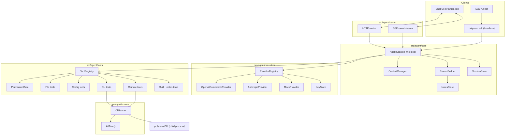
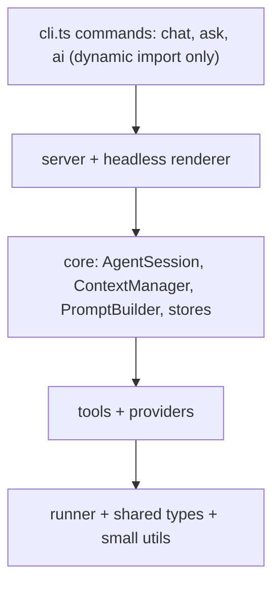
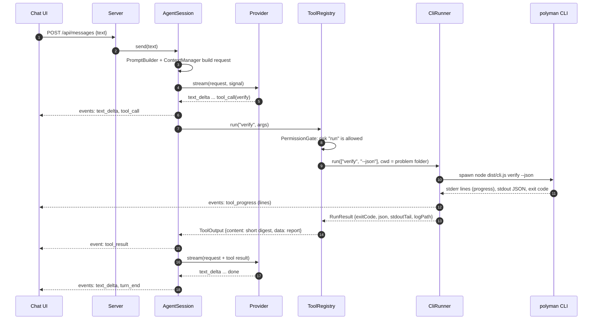
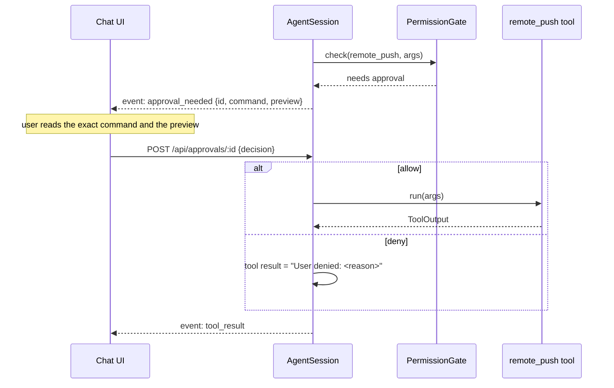
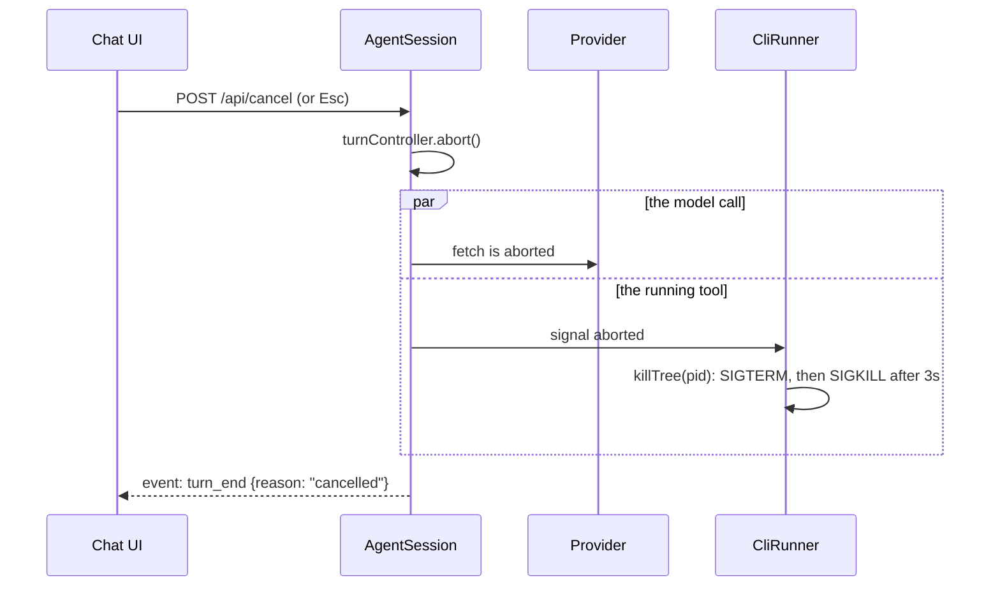
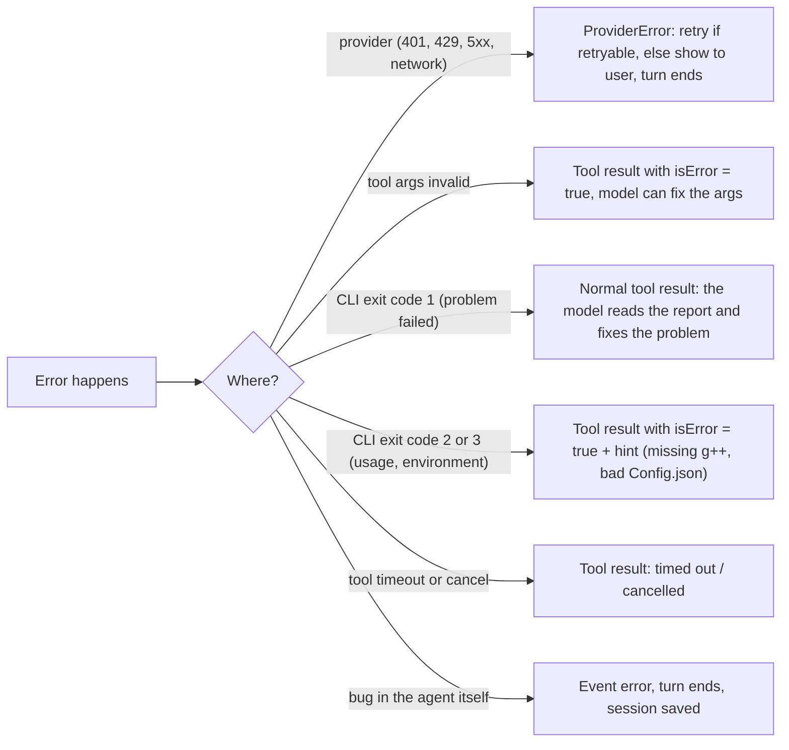

# 01: Architecture

This file is the map. The other files go deeper into each part.

## Components



## Layers and import rules

Each layer may only import from the layers under it. This keeps the parts testable on their own.



Rules:

- `src/agent/**` never imports `actions.ts`, `steps.ts` or `helpers/**` that print or exit. It runs the CLI instead (decision D1).
- It may import pure modules that do not print or exit, like `types.d.ts` and the JSON report types.
- `cli.ts` loads the agent with `await import('./agent/index.js')`, so normal commands do not load it.
- Providers know nothing about tools running. Tools know nothing about providers.

## Source layout

```
src/agent/
  index.ts                 startChat(), runAsk(), aiCommands()
  core/
    session.ts             AgentSession: the loop, turns, steps, cancel
    events.ts              AgentEvent union + EventBus
    messages.ts            Message, ContentPart (provider-neutral)
    context.ts             ContextManager: budget, truncation, compaction
    prompt.ts              PromptBuilder: system prompt from parts
    session-store.ts       JSONL sessions on disk
    notes.ts               NotesStore: read/update notes.md
  providers/
    types.ts               Provider, ChatRequest, StreamEvent, ModelInfo
    openai-compatible.ts
    anthropic.ts
    presets.ts             known providers: base URL, env var, models, prices
    capabilities.ts        ModelCapabilities lookup + overrides
    registry.ts            resolve provider + model from settings
    key-store.ts           ~/.polyman/ai.json (0600) + env vars
    retry.ts               backoff, retry-after, error mapping
    sse-parser.ts          parse text/event-stream from fetch()
    mock.ts                scripted provider for tests and evals
  tools/
    types.ts               Tool, ToolContext, ToolOutput, Risk
    registry.ts            register, list specs, validate args, dispatch
    permissions.ts         PermissionGate: policies, session rules, approvals
    schema.ts              small JSON schema validator (subset)
    sandbox.ts             resolve paths inside the problem folder
    fs-tools.ts            list_files, read_file, write_file, edit_file
    config-tools.ts        read_config, update_config
    cli-tools.ts           create_problem, generate, validate, run_solution, test, verify, stress
    remote-tools.ts        remote_pull, remote_push, remote_commit, remote_view, remote_package
    skill-tools.ts         list_skills, load_skill
    notes-tools.ts         read_notes, update_notes
  runner/
    cli-runner.ts          spawn polyman, collect output, timeout, cancel
    kill-tree.ts           kill a process tree on POSIX and Windows
  server/
    http.ts                routes, static files, auth token, Host check
    sse.ts                 event stream with Last-Event-ID replay
    protocol.ts            request/response types shared with ui/
  headless/
    ask.ts                 polyman ask: text or --json renderer
ui/                        web UI source (Vite + React, dev dependencies only)
dist/ui/                   built UI, shipped in the npm package
evals/                     eval cases and runner (not shipped)
```

## Main flows

### A chat turn with one tool call



### A tool call that needs approval



### Cancel



The session stays alive after a cancel. Only the current turn stops.

## Data on disk

| Path | What | Who writes it |
| --- | --- | --- |
| `~/.polyman/credentials.json` | Polygon key and secret (exists today) | `polyman remote register` |
| `~/.polyman/ai.json` | Provider keys, default provider and model, overrides. Mode `0600`. | `polyman ai login`, settings in the UI |
| `~/.polyman/agent/sessions/` | Sessions that started before a problem folder existed | SessionStore |
| `<problem>/.polyman/agent/notes.md` | Long-term memory of the problem | NotesStore, `update_notes` tool |
| `<problem>/.polyman/agent/sessions/<id>.jsonl` | One file per chat, append-only | SessionStore |
| `<problem>/.polyman/agent/logs/<callId>.log` | Full output of each CLI run | CliRunner |
| `<problem>/.polyman/cache/` | Compile cache (exists today) | CLI |

The agent never reads `credentials.json` or `ai.json` through its tools. The sandbox blocks paths outside the problem folder.

## Error model



The rule: a failed tool is information for the model, not a crash. Only provider errors that cannot be retried and bugs in the agent end a turn.

## Security model

| Risk | What we do |
| --- | --- |
| Another website talks to the local server | Bind to `127.0.0.1` only, a random token in the URL and in every request, check the `Host` header (blocks DNS rebinding). |
| The model writes outside the problem | All file tools go through `sandbox.ts`: resolve the real path and refuse anything outside the problem folder, and refuse `.polyman/cache`. |
| The model changes Polygon by mistake | Remote tools are risk `remote` and always need approval. The UI shows the exact command. |
| Prompt injection from pulled statements or files | Content from files is data. Dangerous actions still need approval, so injected text cannot push or commit. |
| API keys leak | Keys stay in `ai.json`, are sent only to their own base URL, and are removed from logs, errors and session files. |
| Unreleased problems leak to a provider | Clear notice the first time a provider is used. Ollama works fully offline. |
| Code written by the model runs on the machine | Same as today: polyman already compiles and runs user code. The agent only runs it through the CLI, with the CLI time and memory limits. |

## Testing strategy

| Layer | How we test it |
| --- | --- |
| Providers | Recorded SSE streams as fixtures, fed to the parser and adapters. No network in CI. |
| CliRunner | A tiny fake CLI script that prints, sleeps, exits with codes, or spawns children (to test `killTree`). |
| Tools | Temp problem folders made from `template/`, with the runner mocked or real. |
| AgentSession | `MockProvider` with a script of replies and tool calls. Check the events and the saved session. |
| Server | Start on a random port, call the HTTP API, read SSE. |
| End to end | `polyman ask --provider mock` on a temp copy of the template problem. |
| Quality of the agent | The eval suite with real models, not in CI (see [08-evals-release.md](08-evals-release.md)). |
