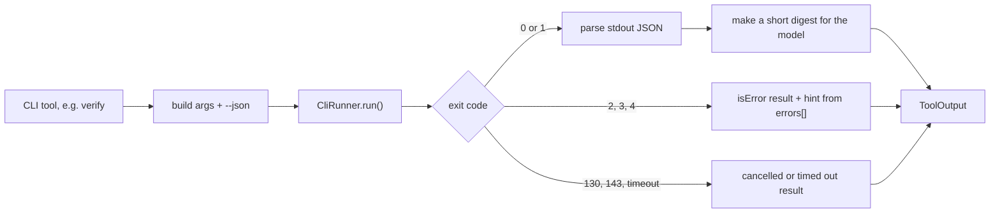

# 02: CLI contract (M0)

The agent runs the CLI as a child process (decision D1). So the CLI output and exit codes become an API. This file defines that API.

## What exists today

- `polyman run <solution> --json` and `polyman verify --json` print one JSON document to stdout. Human output goes to stderr (`src/report.ts`).
- Types: `RunReport`, `VerifyReport`, `TestResult`, `StepResult`, `SolutionResult` in `src/types.d.ts`.
- Prompts already fail with a clear error when stdin is not a terminal, and `remote push` has `--yes` and `--name` (`src/steps.ts`).
- chalk turns colors off when stdout is not a terminal.
- Every failure exits with `1`.

## Exit codes

| Code | Name | Meaning | What the agent does |
| --- | --- | --- | --- |
| `0` | OK | The command did what was asked | Continue |
| `1` | PROBLEM_FAILED | The command ran, but the problem is wrong: a test failed validation, a solution does not match its tag, a checker test failed | Read the report and fix the problem |
| `2` | USAGE_ERROR | Bad arguments, unknown solution name, invalid `Config.json` | Fix its own command or the config |
| `3` | ENVIRONMENT_ERROR | Missing `g++`, `java`, `python`, `testlib.h`, Polygon credentials | Tell the user, do not retry |
| `4` | REMOTE_ERROR | Polygon API or network failed | Retry once, then tell the user |
| `130` | CANCELLED | SIGINT | Nothing, the user cancelled |
| `143` | TERMINATED | SIGTERM | Nothing, the runner killed it |

Implementation idea:

```ts
// src/errors.ts
export class PolymanError extends Error {
  constructor(
    message: string,
    readonly exitCode: 1 | 2 | 3 | 4,
    readonly hint?: string
  ) {
    super(message);
  }
}
```

- Helpers throw `PolymanError` with the right code instead of `process.exit(1)`.
- `cli.ts` has one place that catches, prints and exits with `error.exitCode`. Unknown errors exit with `1`.
- We can move file by file. Until a file is moved, it keeps exiting with `1`, which is still correct for "failed".

## `--json` for every command the agent uses

Same rule as today: exactly one JSON document on stdout, and all human text on stderr.

```ts
interface ReportBase {
  polymanVersion: string;
  command: string;
  ok: boolean;
  exitCode: number;
  durationMs: number;
  errors: string[]; // plain text, no ANSI
}
```

| Command | Report | Status |
| --- | --- | --- |
| `run` | `RunReport` | done |
| `verify` | `VerifyReport` | done |
| `generate` | `GenerateReport { tests: {testset, index, source: 'manual' or 'generator', generator?, args?, ok, error?}[] }` | new |
| `validate` | `ValidateReport { tests: {testset, group?, index, valid, message}[] }` | new |
| `test validator` / `test checker` | `SelfTestReport { target, cases: {index, expected, actual, ok, message}[] }` | new |
| `test <solution>` | `RunReport` compared with the main solution | new |
| `new`, `download-testlib` | `ReportBase` + `{ path }` | new |
| `list checkers / testsets / solutions / generators` | `ListReport { items: unknown[] }` | new |
| `remote pull / push / commit / view / package` | `RemoteReport { problemId, actions: {component, name, action, ok, error?}[] }` | new |
| `stress` (new command, M3) | `StressReport { iterations, mismatch?: {args, input, outputA, outputB} }` | new |

`VerifyReport` is the most important one: the agent reads it after every fix. It must say which step failed and which test and solution failed, with a short message.

## Running without a terminal

Rules every command must follow:

1. Never wait for input when stdin is not a terminal. Fail with exit code `2` and say which flag to pass.
2. Never print ANSI colors when `NO_COLOR` is set or stdout is not a terminal.
3. Respect `POLYMAN_AGENT=1` (set by the runner): no spinners, no progress bars that redraw lines, one line per event on stderr.

We add a test that runs each command with stdin closed and checks that it ends.

## Node version

chalk 5 is ESM-only and `dist/` is CommonJS, so polyman needs `require(esm)`. That means:

```json
"engines": { "node": "^20.19.0 || >=22.12.0" }
```

`fetch` and `AbortSignal.timeout` (used by M1) are also there in these versions.

## How the runner uses this



If stdout is not valid JSON (a bug or a crash), the runner returns the last 50 stderr lines as the tool result, with `isError = true`.
