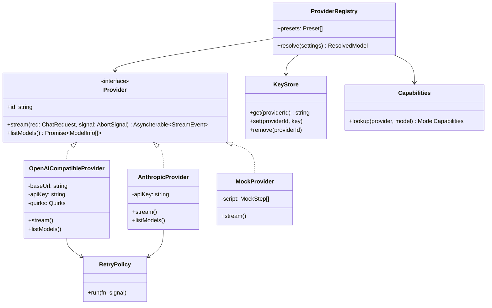
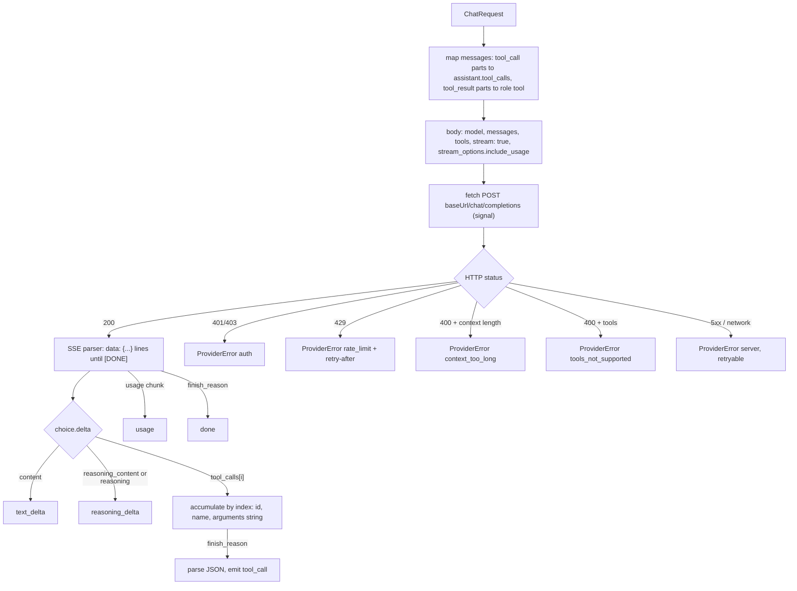
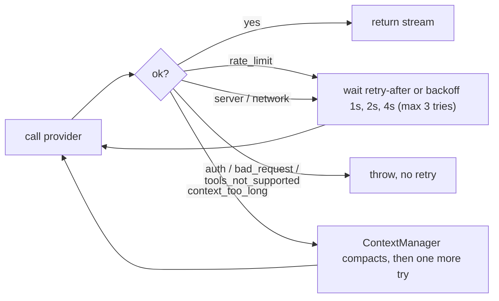

# 03: Providers and keys (M1)

## The problem

Users want to use the key they already have: OpenAI, DeepSeek, Qwen, Gemini, Anthropic, Groq, OpenRouter, a local Ollama, or a company server. We cannot write one client per provider.

The good part: almost all of them accept the OpenAI Chat Completions format. So we need:

- One `OpenAICompatibleProvider`, configured by a base URL. It covers almost everything.
- One `AnthropicProvider` for Claude models (native API, better tool use).
- A list of presets, so users only type a key.
- A "custom" option: any base URL + model + key.

## Classes



## Types

These types are provider-neutral. The core only knows them.

```ts
// src/agent/core/messages.ts
type ContentPart =
  | { type: 'text'; text: string }
  | { type: 'reasoning'; text: string } // shown in the UI, not sent back
  | { type: 'tool_call'; id: string; name: string; args: unknown }
  | { type: 'tool_result'; callId: string; content: string; isError: boolean };

interface Message {
  id: string;
  role: 'user' | 'assistant' | 'tool';
  parts: ContentPart[];
  createdAt: string;
}

// src/agent/providers/types.ts
interface ChatRequest {
  model: string;
  system: string;
  messages: Message[];
  tools: ToolSpec[]; // { name, description, parameters: JSONSchema }
  maxOutputTokens?: number;
  temperature?: number;
  reasoningEffort?: 'low' | 'medium' | 'high';
}

type StreamEvent =
  | { type: 'text_delta'; text: string }
  | { type: 'reasoning_delta'; text: string }
  | { type: 'tool_call'; id: string; name: string; args: unknown } // emitted when complete
  | { type: 'usage'; inputTokens: number; outputTokens: number; cachedTokens?: number }
  | { type: 'done'; stopReason: 'end' | 'tool_calls' | 'max_tokens' | 'content_filter' };

interface Provider {
  id: string;
  stream(req: ChatRequest, signal: AbortSignal): AsyncIterable<StreamEvent>;
  listModels?(signal: AbortSignal): Promise<ModelInfo[]>;
}

class ProviderError extends Error {
  kind: 'auth' | 'rate_limit' | 'context_too_long' | 'bad_request'
      | 'server' | 'network' | 'tools_not_supported';
  status?: number;
  retryAfterMs?: number;
  retryable: boolean;
}
```

Why a tool call is emitted only when complete: providers stream the arguments in pieces, and each one does it a bit differently. The adapter collects the pieces and parses the JSON once. The core never sees half arguments. The UI still shows "calling verify..." from the first piece through a separate `tool_call_started` event if we want it later.

## OpenAI-compatible adapter



Quirks we already know about, kept in a `Quirks` object per preset:

| Quirk | Example | Handling |
| --- | --- | --- |
| `stream_options` not accepted | some older servers | retry once without it, remember for the session |
| Reasoning text field | DeepSeek `reasoning_content`, OpenRouter `reasoning` | map to `reasoning_delta`, never send it back |
| Tool arguments not valid JSON | small local models | try to fix common problems (trailing text), else send an error tool result so the model tries again |
| No tool support | some local models | `tools_not_supported`, then chat-only mode for this model |
| Max tokens field name | `max_tokens` vs `max_completion_tokens` | per preset |

## Anthropic adapter

Same events, different mapping:

- `system` goes in the top-level `system` field.
- Tool calls are `tool_use` content blocks. The arguments come as `input_json_delta` pieces.
- Tool results are `tool_result` blocks inside a `user` message.
- `thinking` blocks map to `reasoning_delta`.
- Prompt caching: mark the system prompt and the tool list with `cache_control`, since they are the same in every step.

## Presets

```ts
interface Preset {
  id: string;            // 'deepseek'
  label: string;         // 'DeepSeek'
  adapter: 'openai' | 'anthropic';
  baseUrl: string;
  envVar: string;        // 'DEEPSEEK_API_KEY'
  keyRequired: boolean;  // false for ollama
  quirks?: Partial<Quirks>;
  models: ModelInfo[];   // known models, with capabilities and prices
}
```

First list (base URLs must be checked again before release):

| id | adapter | base URL | env var |
| --- | --- | --- | --- |
| `openai` | openai | `https://api.openai.com/v1` | `OPENAI_API_KEY` |
| `anthropic` | anthropic | `https://api.anthropic.com` | `ANTHROPIC_API_KEY` |
| `deepseek` | openai | `https://api.deepseek.com/v1` | `DEEPSEEK_API_KEY` |
| `qwen` | openai | `https://dashscope-intl.aliyuncs.com/compatible-mode/v1` | `DASHSCOPE_API_KEY` |
| `gemini` | openai | `https://generativelanguage.googleapis.com/v1beta/openai` | `GEMINI_API_KEY` |
| `groq` | openai | `https://api.groq.com/openai/v1` | `GROQ_API_KEY` |
| `mistral` | openai | `https://api.mistral.ai/v1` | `MISTRAL_API_KEY` |
| `openrouter` | openai | `https://openrouter.ai/api/v1` | `OPENROUTER_API_KEY` |
| `ollama` | openai | `http://localhost:11434/v1` | none |
| `custom` | openai | from the user | from the user |
| `polyman` (M6) | openai | our server | from `polyman ai login polyman` |

## Model capabilities

```ts
interface ModelCapabilities {
  tools: boolean;
  parallelToolCalls: boolean;
  reasoning: boolean;
  contextWindow: number;   // tokens
  maxOutput: number;
  pricePerMTokIn?: number; // USD, for the cost display
  pricePerMTokOut?: number;
}
```

Lookup order: user override in `ai.json`, then the preset model list, then safe defaults (`tools: true`, `contextWindow: 32000`). If a call fails with `tools_not_supported`, we set `tools: false` for that model and tell the user that this model can only chat, not build the problem.

## Keys and settings

`~/.polyman/ai.json`, file mode `0600`, folder mode `0700`:

```json
{
  "version": 1,
  "default": { "provider": "deepseek", "model": "deepseek-chat" },
  "providers": {
    "deepseek": { "apiKey": "sk-..." },
    "custom": { "baseUrl": "https://my-server/v1", "apiKey": "...", "models": ["my-model"] }
  },
  "overrides": { "deepseek/deepseek-chat": { "contextWindow": 64000 } },
  "acceptedPrivacyNotice": ["deepseek"]
}
```

Key lookup order: the env var, then `ai.json`. Rules:

- `polyman ai login <provider>` reads the key with a hidden prompt (or `--key-stdin`), never from argv, so it does not end up in shell history.
- A key is only ever sent to the base URL of its own preset.
- The `redact()` helper removes known keys from every log line, error message and saved session.

Commands:

| Command | What it does |
| --- | --- |
| `polyman ai login <provider>` | save a key, then test it |
| `polyman ai logout <provider>` | remove a key |
| `polyman ai list` | providers, which have keys (masked), the default |
| `polyman ai models [provider]` | known models + `listModels()` from the API |
| `polyman ai use <provider>/<model>` | set the default |
| `polyman ai test [provider/model]` | one tiny request with one tool, to check keys and tool support |

## Retries



We only retry before the first streamed byte. If the stream breaks in the middle, we stop the step and show an error, since we cannot know what the model already did.

## Tests

- SSE fixtures recorded once from each provider (text only, tool call, two tool calls, reasoning, error) and replayed in Vitest.
- `MockProvider` takes a script: `[{ text: 'ok' }, { toolCall: { name: 'verify', args: {} } }, ...]`.
- `polyman ai test` is the manual check with real keys.
