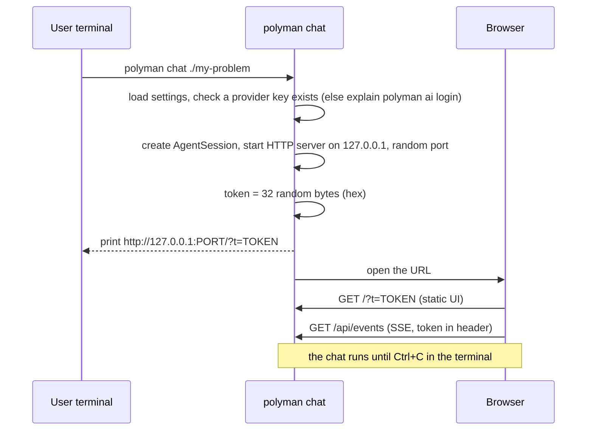
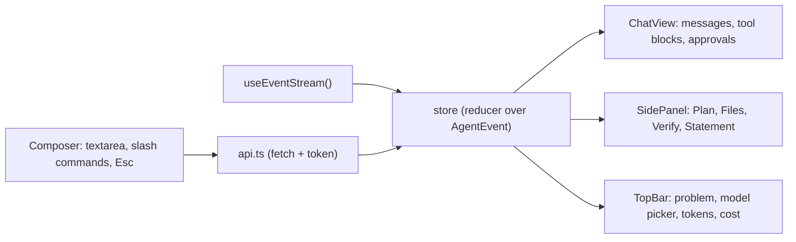

# 05: Chat UI (M2 first version, M5 polish)

## Why a local web page

Problem setting needs to show many things at once: the chat, the files, the diff of an edit, the verify table, the checklist. A browser does this well. A terminal UI would need a lot of work for less. (Decision D3. A terminal client can come later, it would read the same events.)

## How it starts

```
polyman chat [dir] [--port 0] [--no-open] [--provider p --model m] [--resume <id>]
```



If the folder has no `Config.json`, the chat starts in "no problem yet" mode. This is normal for the "think" step.

## Security

- Listen on `127.0.0.1` only.
- Every API request must have the token (`Authorization: Bearer <token>`, or `?t=` only for the first page load, then the UI keeps it in memory).
- Check the `Host` header is `127.0.0.1:<port>` or `localhost:<port>`. This blocks DNS rebinding.
- No CORS headers, so other sites cannot read the responses.
- Static files are served from `dist/ui` only, with a fixed list of files.

## HTTP API

| Method and path | Body / query | Returns |
| --- | --- | --- |
| `GET /api/state` | | session id, problem dir, model, mode, notes, is a turn running, pending approvals |
| `GET /api/events` | `Last-Event-ID` header | SSE stream of `AgentEvent` with `id: seq` |
| `POST /api/messages` | `{ text }` | `202`, or `409` if a turn is running |
| `POST /api/cancel` | | `202` |
| `POST /api/approvals/:id` | `{ decision: 'allow' or 'allow_session' or 'deny', reason? }` | `200` |
| `GET /api/settings` | | providers with keys (masked), models, current model, permission mode |
| `PUT /api/settings` | `{ provider?, model?, mode? }` | new settings (model change applies to the next turn) |
| `GET /api/sessions` | | sessions of this problem |
| `POST /api/sessions/:id/resume` | | `200`, UI reloads state |
| `GET /api/files` | `?path=` | file tree, or one file content (read-only, through the sandbox) |
| `GET /api/report/latest` | | last `VerifyReport` |

The types live in `src/agent/server/protocol.ts`, and the UI imports the same file at build time.

## SSE stream

```
id: 812
event: agent
data: {"type":"tool_call","callId":"c7","name":"verify","args":{},"risk":"run"}

id: 813
event: agent
data: {"type":"tool_progress","callId":"c7","line":"Compiling main.cpp"}
```

- A heartbeat comment every 15 seconds keeps the connection open.
- On reconnect, the browser sends `Last-Event-ID` and the server replays the missed events from the `EventBus` buffer. If the buffer does not have them anymore, the UI calls `/api/state` and reloads the transcript from the session.

## Layout

```
+----------------------------------------------------------------------------+
| polyman  |  pairs-sum (Polygon #123456)  |  deepseek/deepseek-chat v |  12.3k tok  $0.02  |
+------------------------------------------+---------------------------------+
|                                          | [Plan] [Files] [Verify] [Statement]
|  You: I have an idea about pairs ...     |                                 |
|                                          |  Plan (notes.md)                |
|  Agent: Nice, let us fix the constraints |  [x] idea and constraints       |
|  first. n up to 2e5, a_i up to 1e9 ...   |  [x] statement (english)        |
|                                          |  [ ] solutions: main, wa-greedy |
|  > verify                     [running]  |  [ ] validator + tests          |
|    Compiling main.cpp                    |  [ ] generators + script        |
|    Running wa-greedy on tests ...        |  [ ] checker                    |
|                                          |  [ ] verify passes              |
|  +------------------------------------+  |  [ ] push to Polygon            |
|  | Allow: write_file validator/val.cpp|  |                                 |
|  | (diff)                             |  |                                 |
|  | [Allow] [Allow for session] [Deny] |  |                                 |
|  +------------------------------------+  |                                 |
+------------------------------------------+---------------------------------+
| Type a message ...                                    [Send]  [Stop (Esc)] |
+----------------------------------------------------------------------------+
```

Right panel tabs:

- **Plan**: notes.md rendered, with the checklist. Updated on `notes_updated`.
- **Files**: the file tree and a read-only viewer. Files the agent changed in this session are marked.
- **Verify**: the last `VerifyReport` as a table: solutions as rows, verdicts per testset, failures in red.
- **Statement**: a simple preview of the `.tex` files (M5, a basic LaTeX to HTML for the common commands only).

## UI code



- `ui/` folder at the repo root: Vite + React + TypeScript. All of these are dev dependencies.
- `npm run build` runs `tsc` and then `vite build --outDir dist/ui`. `package.json` `files` adds `dist/ui/**`.
- Markdown rendering and code highlighting are bundled into the UI build, so they add nothing to the runtime install.
- The store is one reducer over `AgentEvent`. The same reducer can be tested in Vitest without a browser.

## First version (M2) vs polish (M5)

| M2 (first usable chat) | M5 (polish) |
| --- | --- |
| Transcript with streamed markdown | Slash commands: `/model`, `/mode`, `/clear`, `/resume`, `/cost`, `/help` |
| Tool blocks (collapsed), progress lines | Diff view for `write_file` / `edit_file` approvals and results |
| Approval card with exact command | Verify tab as a table, Statement preview tab |
| Stop button and Esc | Token and cost in the top bar, per turn and total |
| Model picker | Files tab with "changed in this session" marks |
| Plan tab (notes.md as markdown) | Keyboard shortcuts, input history |
