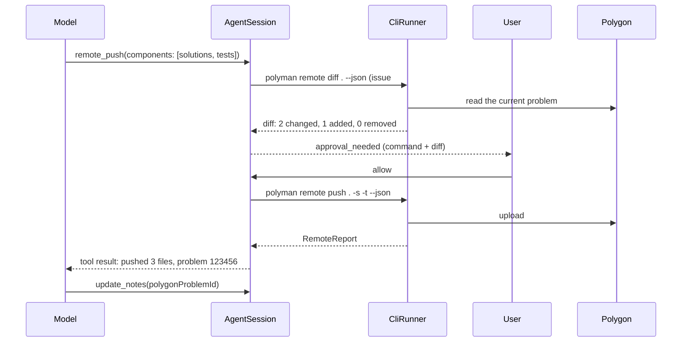
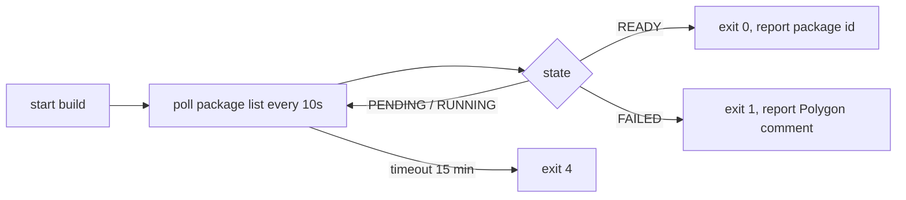

# 07: Polygon from the chat (M4)

The CLI already has `remote pull`, `push`, `commit`, `view` and `package`. M4 makes them safe to use from the chat.

## Rules

1. Every remote tool has risk `remote`. It always asks, even in `auto-edit` mode.
2. The approval shows the exact command, and for `push`, what will change on Polygon.
3. Polygon credentials stay in `~/.polyman/credentials.json`. The CLI reads them. The agent never sees them.
4. After a push, the agent writes the Polygon problem id into the notes.

## Tools

| Tool | CLI command | Approval shows |
| --- | --- | --- |
| `remote_view(problemId)` | `polyman remote view <id> --json` | nothing, it is read-only (risk `read`, no approval) |
| `remote_pull(problemId, components)` | `polyman remote pull <id> <dir> -s -c ...` | which local files will be overwritten |
| `remote_push(components, newProblemName?)` | `polyman remote push . -s -t ... --json` | the diff: what is added, changed, removed on Polygon |
| `remote_commit(message)` | `polyman remote commit <id> "<message>"` | the message |
| `remote_package(type)` | `polyman remote package <id> <type> --wait --json` | the type |

## Push with preview

Until `remote diff` (#10) exists, the approval shows only the command and the list of components. This is ok for the first version.

## Package build

Building a package on Polygon takes time. Today `remote package` starts the build. We add `--wait`:

The tool streams the state lines as `tool_progress`, so the user sees it moving.

## Pull into an empty chat

A user can also start from Polygon: "pull problem 123456 and check the tests". Then:

1. `remote_pull` into a new folder (approval shows the folder).
2. `problem_dir_changed`, the session moves to the folder.
3. The agent writes notes from what it reads (statement, config), and marks the done steps.

## Related issues

- #10: `remote diff` and `push --dry-run`. Needed for the push preview.
- #6: Java class names after pull. The agent will hit this if a pulled problem has Java solutions.
