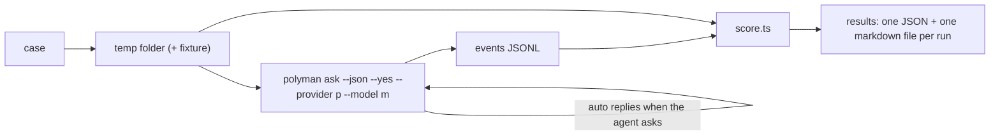

# 08: Evals, cost and release (M5)

## Why evals

Models are very different at long tool work. We cannot say "DeepSeek works" because one chat went well. We need numbers, for each model, on the same tasks. The evals also catch regressions when we change the prompt or the tools.

## Eval cases

```
evals/
  cases/
    pairs-sum/
      case.json        task, user replies, limits
      reference/       hidden: a correct solution and a few hidden tests
    shortest-path/
    ...
  run.ts               runner
  score.ts             scoring
  results/             JSON + markdown per run (gitignored)
```

```json
{
  "id": "pairs-sum",
  "kind": "full",
  "prompt": "I want a problem: count pairs with sum k. n up to 2e5. Build it with a WA solution for int overflow and a TL brute force.",
  "autoReplies": ["yes, go ahead", "english only"],
  "maxSteps": 120,
  "maxCostUsd": 1.0
}
```

Kinds:

| Kind | Starts from | Task |
| --- | --- | --- |
| `full` | empty folder | idea to passing verify |
| `fix` | a broken problem (copy of a fixture) | make verify pass |
| `tests` | a problem with weak tests | add tests until the WA solution fails |
| `validator` | a problem without validator | write the validator and its tests |

## Runner



## Scores

| Score | How |
| --- | --- |
| `verifyPassed` | `polyman verify --json` in the folder at the end |
| `correct` | the hidden reference solution passes the agent's tests, and the agent's main solution passes the hidden tests (catches "a problem that verifies, but is not the asked problem") |
| `testsStrong` | the WA and TL solutions from the case fail on the agent's tests |
| `steps`, `toolErrors` | from events |
| `tokens`, `costUsd`, `timeSec` | from `usage` events |

A model is "supported" if it passes most `full` cases under the cost limit. The README lists supported models with their numbers.

## Cost display

- `usage` events have tokens. If the model has prices in the presets, we compute `costUsd`.
- The top bar shows this turn and the session total.
- Unknown prices show tokens only. Users can add prices in `ai.json` overrides.

## Docs

- `GUIDE.md`: a new "Chat" section (start, providers, permissions, workflow, notes, resume).
- `README.md`: a short section and the supported models table.
- A privacy note: what is sent to the provider (statement, code, test samples, reports), that unreleased problems should go to a provider you trust or to Ollama, and that keys stay on the machine.
- `template/CLAUDE.md` and `AGENTS.md`: mention `.polyman/agent/`.

## Release

- Version `4.0.0`: new commands and new exit codes are visible changes.
- Before release: run the evals on at least 3 providers, test `polyman chat` on Linux, macOS and Windows, check the package size with `dist/ui`.
