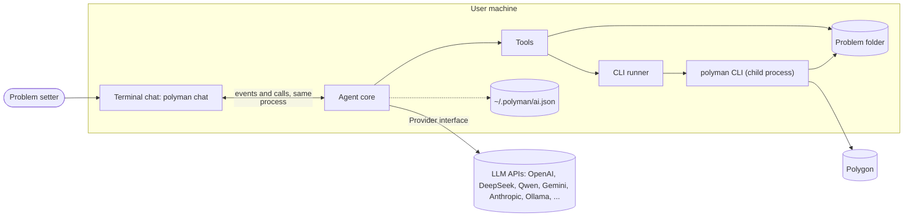
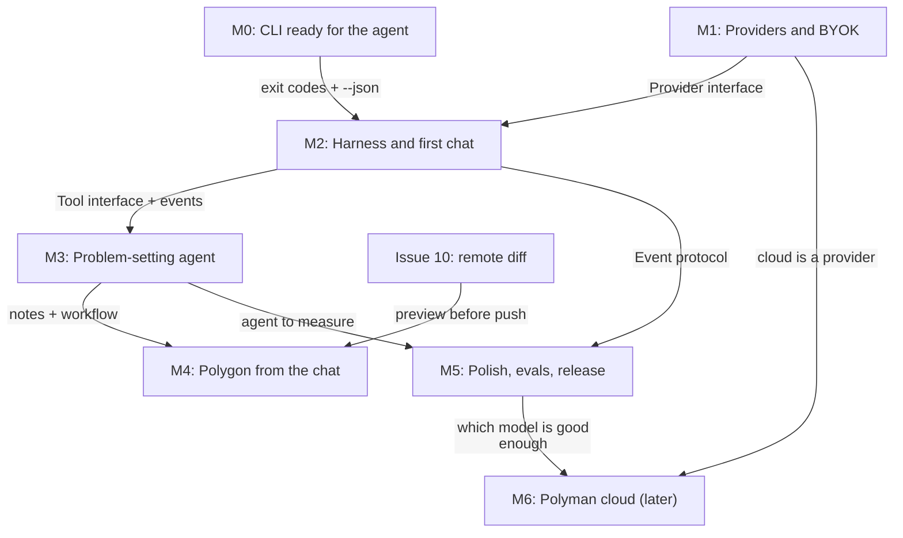

# Polyman Agent: design

Status: draft, initial ideas. Everything here can change while we build it.
Tracking issue: #30. Epics: M0 #31, M1 #32, M2 #33, M3 #34, M4 #35, M5 #36, M6 #37.

## What we are building

`polyman chat` opens a chat that works with the problem setter from the first idea to a ready Polygon problem:

1. Think about the problem with the user: the story, the constraints, the intended solution, wrong approaches and edge cases.
2. Create the problem folder, then write the statement, `Config.json`, solutions, validator, generators, checker and tests.
3. Run `verify`, read the failures, fix them, and repeat until it passes.
4. Push to Polygon, commit and build the package, always after the user says yes.

Users bring their own API key (OpenAI, DeepSeek, Qwen, Gemini, Anthropic, Groq, OpenRouter, Ollama, or any OpenAI-compatible server). Later we may run our own server so users can use the chat without a key ("polyman cloud").

## Goals

- The chat is part of polyman. Users do not need any other agent tool.
- Any provider with a key works. Local models (Ollama) work for private problems.
- The agent never breaks the problem silently: every change is a file the user can see, and every Polygon change needs approval.
- The CLI stays the source of truth. The agent uses the same commands a human uses.

## Non-goals (for now)

- No free shell tool. The agent can only run polyman commands and edit files inside the problem folder.
- No multi-user or team chat.
- No IDE extension and no web UI. The chat lives in the terminal, like Claude Code or Codex.
- No hosted server in the first release (see [09-cloud.md](09-cloud.md)).

## Decisions

| # | Decision | Why |
| --- | --- | --- |
| D1 | The agent runs the polyman CLI as a child process. It does not import `actions.ts` or `steps.ts`. | A crash or `process.exit` in the CLI cannot kill the chat. No big refactor of the core. |
| D2 | One npm package (`polyman-cli`). The agent code is loaded with `import()` only by `chat`, `ask` and `ai`. | `polyman verify` does not get slower to start. One version to install. |
| D3 | The chat is a terminal UI (TUI) built with Ink, in the same process as the agent. Like Claude Code or Codex. | Problem setters already live in the terminal. No server, no ports, no browser. |
| D4 | Our own thin provider layer: one OpenAI-compatible adapter and one Anthropic adapter. | Almost every provider speaks the OpenAI format. Same style as our hand-written Polygon client. No big SDK. |
| D5 | The agent core and providers add no runtime dependencies (`fetch`, our own SSE parser). The TUI adds `ink`, `react` and `marked`, loaded only by `polyman chat`. | Ink solves streaming, redraw and input, which is a lot of work to write ourselves. Other commands do not load it. |
| D6 | The hosted server, if we build it, is just one more provider. | The chat does not change when the server comes. |
| D7 | Long-term memory is a notes file in the problem folder (`.polyman/agent/notes.md`). | Long sessions lose context. A new session must know what was decided. |
| D8 | Knowledge comes from `template/instructions/*.md`, loaded as skills when needed. | This knowledge already exists and is kept up to date with the CLI. |

## The big picture

## Documents

| File | What it covers | Milestone |
| --- | --- | --- |
| [01-architecture.md](01-architecture.md) | Components, layers, source layout, main flows, data on disk, security, testing | all |
| [02-cli-contract.md](02-cli-contract.md) | Exit codes, `--json` reports, running without a terminal | M0 |
| [03-providers.md](03-providers.md) | Provider interface, adapters, presets, keys, retries | M1 |
| [04-harness.md](04-harness.md) | Agent loop, events, tools, permissions, CLI runner, sessions, context | M2 |
| [05-chat-ui.md](05-chat-ui.md) | Terminal chat UI: look, Ink setup, components, keys, slash commands | M2, M5 |
| [06-problem-agent.md](06-problem-agent.md) | The problem-setting workflow, notes, skills, tools per step | M3 |
| [07-polygon.md](07-polygon.md) | Polygon tools, approvals, preview before push | M4 |
| [08-evals-release.md](08-evals-release.md) | Eval suite, cost, docs, release | M5 |
| [09-cloud.md](09-cloud.md) | The hosted server idea | M6 |

## Milestones and how they connect

Each arrow is a contract. If the contract is stable, the two sides can be built in parallel:

| Contract | Defined in | Produced by | Used by |
| --- | --- | --- | --- |
| Exit codes and `--json` reports | [02-cli-contract.md](02-cli-contract.md) | M0 (CLI) | M2 runner, M3 and M4 tools |
| `Provider` and `StreamEvent` | [03-providers.md](03-providers.md) | M1 adapters | M2 agent loop |
| `Tool` and `ToolContext` | [04-harness.md](04-harness.md) | M2 | M3 and M4 tools |
| `AgentEvent` and `AgentSession` methods | [04-harness.md](04-harness.md) | M2 core | Terminal UI, `polyman ask`, evals |
| `notes.md` format | [06-problem-agent.md](06-problem-agent.md) | M3 | M4, M5, new sessions |

Order: M0 first. M1 and M2 together (M2 can start with the mock provider). Then M3, which is the product itself, then M4 and M5. M6 only after the evals give real numbers.

## Glossary

- **Turn**: one user message and everything the agent does until it answers.
- **Step**: one model call inside a turn. A turn can have many steps (model, tools, model, tools, ...).
- **Tool**: a function the model can call, like `verify` or `write_file`.
- **Skill**: a markdown guide from `template/instructions/` the agent loads when it needs it.
- **Session**: one chat, saved to disk so it can be resumed.
- **Notes**: `.polyman/agent/notes.md`, the long-term memory of a problem.
